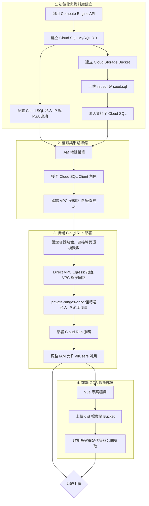
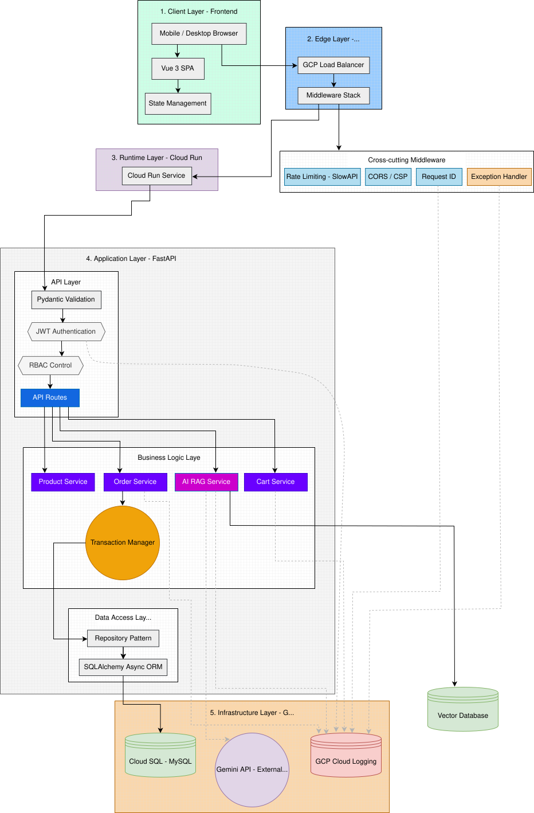

# Coffee Hub — 職人咖啡交易平台

## 專案介紹

Coffee Hub 是使用 FastAPI、Vue 3 與 MySQL 開發的咖啡商品交易系統，包含會員、商品、購物車及訂單管理。專案曾部署至 GCP，目前也提供 Docker 本機展示版本。

開發過程著重於後端分層、角色權限與資料一致性。例如結帳失敗時，訂單建立、庫存扣除與購物車更新必須一起回滾；角色異動後，原本核發的 Token 也必須失效。

目前可在本機執行的版本是 **v1.0.0-local**，啟動方式見下方 Docker 章節。

## 主要功能

| 使用者 | 可以做什麼 |
|---|---|
| 訪客 | 瀏覽上架商品與商品詳細資料 |
| Customer | 註冊、登入、更新本人資料、管理購物車、建立模擬訂單及提出取消申請 |
| Seller | 經 Admin 核准後，以同一帳號管理本人商品、上傳圖片、查詢本人銷售品項及標記出貨；也可作為買家購物 |
| Admin | 審核 Seller 申請、管理會員與商品、核准或拒絕取消申請、完成訂單及查詢 Audit Log |

訂單保留成交時的商品與價格快照。混合多位 Seller 的訂單由各 Seller 標記自己的品項，全部出貨後才更新整單狀態；任一品項出貨後，不再接受一般整單取消。

## GCP 雲端部署

使用 Cloud Run 部署後端、Cloud SQL 管理 MySQL 資料庫，並透過 GCS 提供前端靜態網站。以下整理使用的雲端服務、網路設定與部署流程。

### 部署服務

| 服務 | 使用方式 |
|---|---|
| Cloud Run | 依後端 Dockerfile 建置映像，設定容器連接埠與環境變數，執行 FastAPI |
| Cloud SQL | 使用 MySQL 8.0，透過私人 IP 提供資料庫連線 |
| Google Cloud Storage（GCS） | 代管 Vue 的 `dist` 靜態檔案，設定公開讀取與 `index.html` 入口；也用於 SQL 匯入流程 |
| IAM | 設定服務帳號的 Cloud SQL Client 等權限；Cloud Run 入口允許公開叫用，受保護 API 仍由應用程式驗證身分與權限 |
| VPC／私人網路 | Cloud Run 使用 Direct VPC Egress，經 VPC 子網路連到 Cloud SQL 私人 IP；Cloud SQL 的私有服務連線使用 PSA（Private Services Access） |

Cloud Run 採用 **Direct VPC Egress（直接 VPC 輸出）**，不建立 Serverless VPC Access Connector。流量設定為 `private-ranges-only`，只有私人 IP 範圍的流量會送進 VPC；Cloud SQL 則透過 PSA 建立私有服務連線。

### 部署流程

資料庫先完成私人網路與權限設定，再將 `init.sql`、`seed.sql` 上傳至 GCS 並匯入 Cloud SQL。後端使用 Dockerfile 建置及部署至 Cloud Run；前端以 `npm run build` 產生 `dist`，再上傳至 GCS 設定靜態網站代管。



GCS 的 `index.html` 入口設定不等於所有 SPA 深層路由都能直接重新整理，路由方式仍需配合前端設定。

### 系統架構圖

<div align="center">
  <a href="docs/architecture.svg" target="_blank">
    
  </a>
</div>

這張圖整理了入口防護、後端分層與資料存取設計。圖中的 **RAG／AI 是規劃內容，未納入已完成功能**；它不是本機 Docker 的容器配置圖。

## Docker 本機部署

`v1.0.0-local` 使用 Docker Compose 啟動以下服務，不需要雲端帳號：

| 服務 | 用途 |
|---|---|
| Vue 3 + Nginx | 提供網頁、靜態商品圖片，並將 API 請求轉送至後端 |
| FastAPI + Uvicorn | 處理登入、權限與業務流程 |
| MySQL 8 | 儲存會員、商品、訂單與審計資料 |
| fake-gcs-server | 在本機模擬圖片上傳與儲存流程 |

只有 Nginx 的必要入口綁定 `127.0.0.1`；MySQL、後端及圖片模擬器不直接公開。

### 啟動方式

需要 Git、Docker Desktop（Linux containers）及 PowerShell，不必另外安裝本機 Python 或 Node。下載專案後，在專案根目錄執行：

```powershell
.\scripts\Start-LocalDemo.ps1
# 若 18881 已被使用，可指定其他本機連接埠：
# .\scripts\Start-LocalDemo.ps1 -Port 18882
```

腳本沿用三份 Compose，建立獨立專案與全新 Volume。確認資料庫為空後，才載入一次 `init.sql`、`seed.sql`。若初始化失敗，會保留資源，不清空資料重試。

成功後開啟 **http://localhost:18881**，或使用腳本實際輸出的網址。腳本也會輸出 `state.json` 路徑；請保留同一暫存目錄中的設定與來源快照，不要提交含測試憑證的 `demo.env`。

**再次執行啟動腳本會建立另一套環境，不是更新現有環境。** 若只是重啟或停止，請在專案根目錄使用啟動時的狀態檔：

```powershell
$s = Get-Content '啟動時輸出的 state.json 完整路徑' -Raw | ConvertFrom-Json
$composeArgs = @('compose', '-p', $s.project, '--env-file', $s.env_file,
  '-f', 'docker-compose.integration.yml', '-f', 'docker-compose.local.yml',
  '-f', 'docker-compose.demo.yml')
docker @composeArgs up -d
# 停止服務並保留資料：
# docker @composeArgs stop
```

此啟動方式使用 `docker-compose.integration.yml`、`docker-compose.local.yml` 與 `docker-compose.demo.yml`，不是直接執行根目錄的 `docker-compose.yml`。

### 展示資料與圖片

`seed.sql` 提供 3 種角色、6 項權限、11 筆角色權限關聯、30 位會員、20 筆商品、30 筆訂單與 32 筆明細。Admin 為 user1～user2，Seller 為 user3～user10，Customer 為 user11～user30；登入使用 Email，測試帳密說明見 seed 註解，僅供本機展示。

`init.sql` 已包含遷移 001～005 所需的 Schema；既有資料庫升級另使用 `database/migrations/`。**不要對已有資料的資料庫重新執行 init 或 seed，兩者包含重建／清空指令。**

商品圖片放在 `frontend/public/images/products/`，以 `product-商品ID.png` 命名，也支援 WebP、JPG、JPEG，每個 ID 建議只放一種格式。商品 1～19 已有圖片，商品 20 為下架商品。圖片素材由專案作者確認具備展示使用權。

展示設定會唯讀掛載圖片資料夾，新增或替換圖片後重新整理網頁即可。`VITE_LOCAL_PRODUCT_IMAGES=true` 讓 seed 的外部圖片網址對應到本機檔案；找不到圖片時顯示「暫無圖片」。模擬器的新上傳圖片仍走既有登記流程，瀏覽器不讀取外部圖片來源。

### 展示站與測試站

| 本機網址 | 用途 |
|---|---|
| [http://localhost:18881](http://localhost:18881) | 載入 seed 的展示站，保留展示會員、商品與訂單 |
| [http://localhost:18880](http://localhost:18880) | 使用獨立測試資料的驗收站，供結帳、出貨及取消等寫入測試 |

這兩個網址是本次驗收環境，使用不同 Compose Project 與 Volume。啟動腳本只建立展示環境，不會同時建立 18880 測試站。模擬結帳必須同時設定 `APP_ENV=test`、`ENABLE_SIMULATED_CHECKOUT=true`，請在隔離測試資料上操作。

## 系統設計與技術特色

### 分層與資料存取

API 負責請求與回應格式，Service 處理業務規則及 Transaction（資料庫交易），CRUD 負責資料存取。後端使用 SQLAlchemy Async 搭配 asyncmy 連線 MySQL，以 `async/await` 執行資料庫操作；核心交易由 Service 統一提交，避免不同資料操作各自 Commit，留下只完成一半的結果。

### 訂單與庫存一致性

後端依資料庫價格計算成交金額。建立訂單與明細、扣除庫存及移除本次選取的購物車品項會在同一筆 Transaction 中完成；任何一步失敗就一起 Rollback，不留下部分訂單。

結帳使用防重送鍵識別同一筆請求：相同內容重送會回傳同一張訂單，同一鍵搭配不同內容則拒絕。交易中鎖定購物車與商品資料列，再檢查數量、上架狀態及庫存，避免並行請求超賣。取消核准也會鎖定訂單並檢查退庫存紀錄，最多退還一次。

### 登入與請求防護

密碼以 bcrypt 雜湊儲存，Access／Refresh Token 使用 PyJWT HS256，透過 HttpOnly Cookie 傳送。後端會檢查 JTI Blacklist、資料庫最新角色、帳號狀態與 Token Version（帳號的 Token 版本號）；角色異動或停用時增加版本號，讓所有裝置的既有 Token 失效。一般登出只撤銷目前會話。

Cookie 驗證下的寫入請求需通過 CSRF 檢查，避免其他網站借用登入狀態發送操作。另搭配 CSP 限制資源來源、Rate Limiting 限制請求頻率，以及輸入淨化與 ORM 參數化查詢。

### 圖片與操作紀錄

圖片上傳與商品儲存分開處理：先檢查檔案內容、大小與商品歸屬，將圖片識別碼和預定儲存路徑寫入資料庫，再上傳檔案。即使檔案已存好，但後續資料庫更新失敗，仍能依這筆紀錄追蹤未完成關聯的圖片，留待清理。儲存商品時會再檢查圖片登記狀態與數量；只有新圖成功關聯後，才將換下的圖片列入延後清理，因此替換失敗不會立即刪除原圖。

清理會等保留期結束，再確認圖片沒有被其他商品引用，也沒有保留標記。失敗時會記錄重試時間，供下次清理處理。預設的 dry-run 只列出候選、不刪檔案；實際刪除還需要另外開啟設定，避免檢查清理結果時誤刪圖片。

System Log 記錄執行狀況，Audit Log 記錄操作者、對象與操作結果，request_id 用來串起同一次請求的紀錄。高風險操作與必要審計一起提交，審計寫入失敗時，業務操作也會回滾；Audit Log 查詢限 Admin 使用。

## 測試結果與已知限制

以下是本機版本的驗收範圍。PASS 表示已在列出的範圍完成測試；SIMULATED／Mock 表示使用模擬環境或測試替身；NOT RUN 表示未執行，不將模擬結果視為正式雲端驗收。

| 項目 | 結果 |
|---|---|
| Docker 建置、MySQL 全新初始化與遷移 | PASS，見 Phase 1 紀錄 |
| Chrome 三角色登入／登出、商品頁面及主要管理畫面 | PASS，使用無頭瀏覽器操作 |
| 隔離 MySQL 備份還原、模擬結帳、出貨與取消退庫存 | PASS，見 Phase 3 紀錄 |
| 短時間、小規模 API 效能測試 | PASS；不代表完整容量驗收 |
| 圖片上傳儲存與清理安全測試 | SIMULATED／Mock，見 Phase 2 紀錄 |
| 手機尺寸買家頁面 | SIMULATED，使用 Chrome viewport，非實體手機 |
| 真實 GCS IAM／Generation、實體手機、完整瀏覽器矩陣 | NOT RUN |
| SRS 的 100 帳號／1,000 商品／20 並行效能標準 | NOT RUN |

seed 訂單沒有可信的商品／Seller 快照與扣庫存證據，相關欄位維持 NULL／false，因此不能直接出貨或核准退庫存。新的模擬訂單從購物車建立，不補造 seed 訂單紀錄。

目前不包含正式金流、物流、退款金流或 RAG／AI 推薦。

雲端部署經驗與本機驗收分開記錄，目前不提供持續在線的雲端展示站，操作展示以本機版本為主。

相依套件仍有 **7 個未解安全公告（5 Moderate、2 Low）**，涉及 Pygments、multidict、pytest、Bleach、OpenTelemetry。本機功能通過不代表漏洞已修補、風險已接受或正式安全驗收通過；對外提供服務前仍需處理。

## 專案目錄與相關文件

```text
Coffee-Hub/
├── backend/
│   ├── app/
│   │   ├── api/           # API 路由
│   │   ├── core/          # 設定、驗證、middleware
│   │   ├── crud/          # 資料庫操作
│   │   ├── models/        # SQLAlchemy Models
│   │   ├── schemas/       # Pydantic 請求與回應格式
│   │   └── services/      # 業務規則與交易
│   ├── tests/             # 單元與整合測試
│   └── Dockerfile
├── frontend/
│   ├── public/images/products/
│   ├── src/               # 頁面、元件、Pinia 與 API 呼叫
│   ├── Dockerfile
│   └── nginx*.conf
├── database/              # init.sql、seed.sql、migrations
├── scripts/Start-LocalDemo.ps1
├── docker-compose.*.yml
└── docs/                  # 架構圖、需求、驗收與弱點追蹤
```

- [GitHub 專案](https://github.com/ChouKuangWen/Coffee-Hub)
- [系統需求規格 SRS v0.2](docs/SA/CoffeeHub-System-SRS-v0.2-修訂正式版.md)
- [Phase 1：Docker／MySQL](docs/acceptance/phase1-docker-mysql.json)
- [Phase 2：本機圖片與 Vue API](docs/acceptance/phase2-local.json)
- [Phase 3：本機最終驗收](docs/acceptance/phase3-local.json)
- [相依套件弱點追蹤](docs/security/batch6-dependency-review.json)
