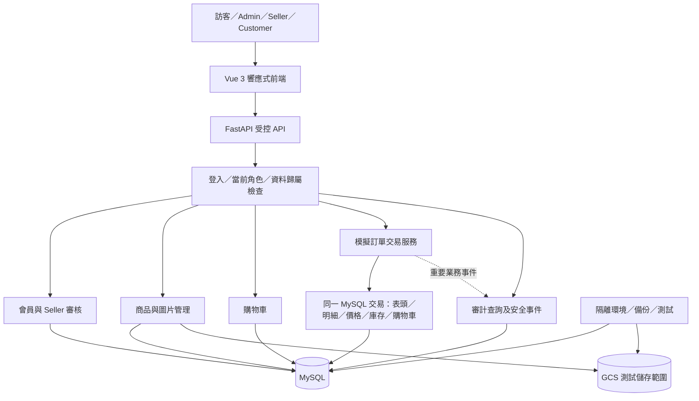
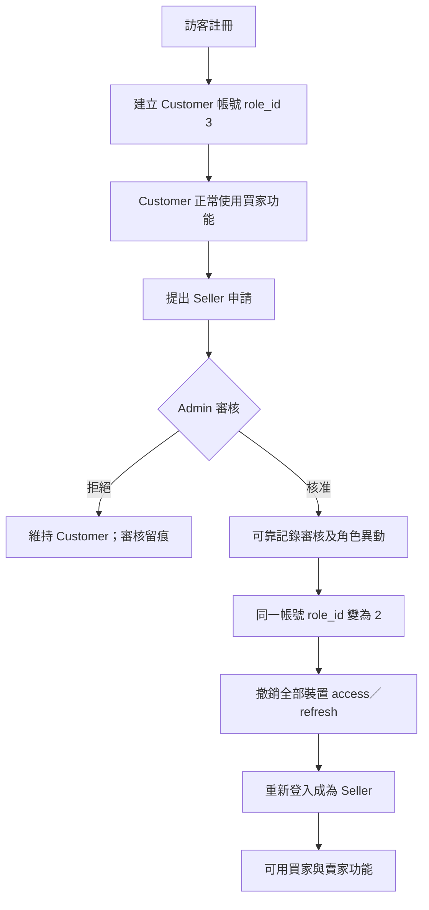
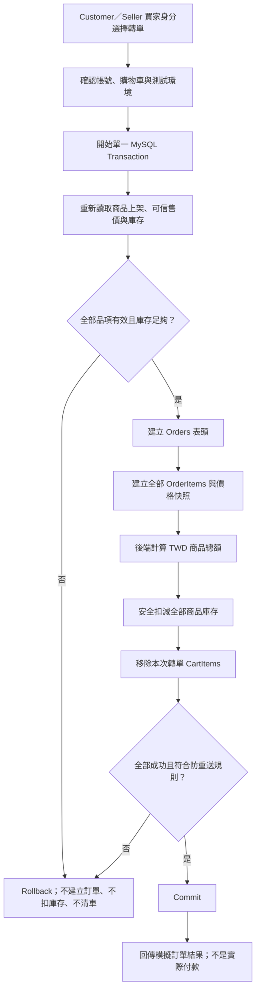
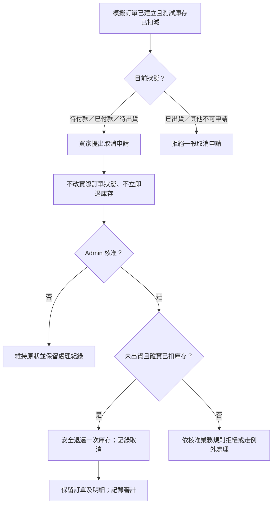
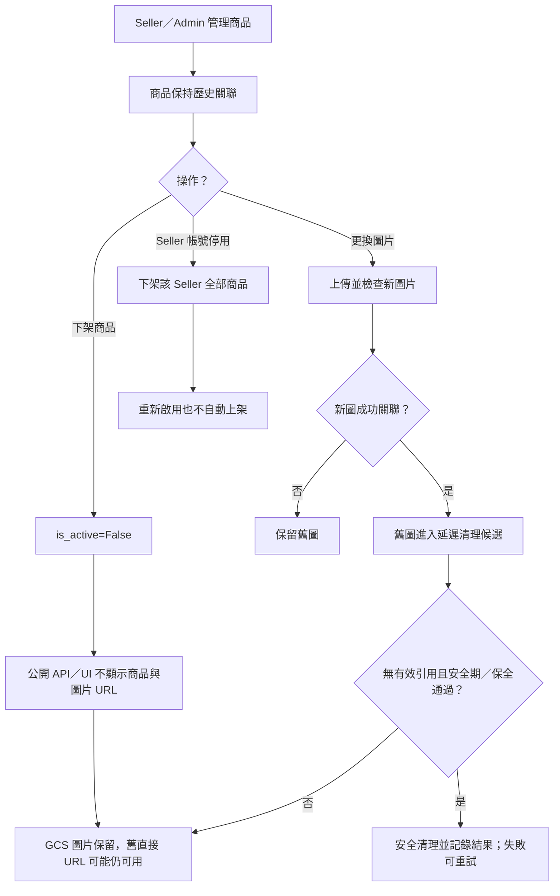

# Coffee Hub — 全系統需求規格書（SRS v0.2）

**系統名稱：** Coffee Hub（咖啡交易與管理平台）

## 文件資訊

| 項目 | 內容 |
|---|---|
| 文件名稱 | Coffee Hub 全系統需求規格書（SRS） |
| 文件版本 | v0.2 |
| 修訂日期 | 2026-11-18 |
| 需求狀態 | DEC-001～DEC-048 已確認；正式簽核與系統驗收另行辦理 |

### 版本變更紀錄

| 版本 | 日期 | 變更內容 |
|---|---|---|
| v0.1 | 2026-11-16 | 建立系統需求初稿及既有系統現況盤點，作為後續需求確認的參考 |
| v0.2 | 2026-11-18 | 確認 48 項需求決策，訂定第一版功能、業務規則、非功能需求與驗收要求 |

---

## Chapter 1 — 文件目的與術語

### 1.1 文件目的

本文件定義 Coffee Hub 第一版應符合的系統需求，包括功能範圍、使用者權限、業務規則、資料需求、非功能需求及驗收要求，供設計、開發、測試與版本管理使用。

**需求以本版 DEC-001～DEC-048 與對應 SYS-FR／SYS-NFR 為準。** 既有程式僅用於分析實作差距，不作為決定需求內容的依據。原始程式現況、證據及尚待修正事項集中於 Chapter 11 與附錄。

### 1.2 名詞與正式用語（DEC-048）

| 名詞 | 正式意義 |
|---|---|
| Coffee Hub | 唯一正式系統名稱；中文描述「咖啡交易與管理平台」 |
| 檢索咖啡 | 商品檢索／瀏覽功能名稱，**不是另一套系統** |
| Admin（角色 1） | 管理員；管理帳號、商品、審核、訂單與審計；第一版**不作買家** |
| Seller（角色 2） | 經 Admin 核准的賣家，同一帳號亦具買家操作能力 |
| Customer（角色 3） | 一般會員／買家，可申請成為 Seller |
| Manager | v0.1 若用於指涉賣家，統一為 Seller；**不新增 Manager 角色** |
| 訪客 | 未登入使用者；只可存取公開功能，不是角色表角色 |
| 模擬訂單 | 隔離測試環境的受控購物車轉單與測試庫存異動，**不代表實際成交／收款／物流** |
| 成交價格快照 | 建單當時由後端取得的商品名稱、單價、數量、賣家 ID 等歷史值 |
| Audit Log（審計紀錄） | 記錄操作者、時間、對象、事件、結果等必要資訊，不儲存完整憑證或不必要個資 |
| SRS／FRD／SD | 系統需求／功能詳細規格／技術設計；本文件不把設計選項冒充已核准需求 |
| Atomicity／Transaction | 原子性／資料庫交易；一組資料變更全部成功或全部失敗 |
| RTO／RPO | 服務復原時間目標／可接受資料損失時間範圍 |
| P95 | 95 百分位回應時間；需指定負載、樣本與量測條件 |

### 1.3 需求追蹤

需求決策集中於 Chapter 13（DEC-001～048）；程式差距集中於 Chapter 11（GAP-01～34）。相關開發與測試成果應記錄對應需求編號、版本及驗收證據。

---

## Chapter 2 — 專案背景、目標與系統邊界

### 2.1 系統目標

Coffee Hub 應讓訪客檢索上架咖啡商品、Customer／Seller 進行買家操作、核准 Seller 管理自有商品與銷售狀態、Admin 管理帳號和平台資料。第一版以**安全、多角色資料隔離、可信定價、受控模擬訂單及原子交易**為核心，不以實際收款為目標。（DEC-001～012、035～039）

### 2.2 第一版核准範圍（In Scope）

| 類別 | 第一版應提供的能力 | DEC |
|---|---|---|
| 帳號與身分 | 註冊 Customer、登入／更新／登出、停用檢查、Seller 申請與 Admin 審核、角色異動立即撤銷會話 | 002、015、018～023 |
| 授權 | Admin／Seller／Customer、買賣雙身分、賣家跨單隔離及買家個資保護 | 002～004、006～008、020～024 |
| 商品 | 咖啡商品建立、更新、價格、庫存、上下架、公開查詢及歷史保護 | 014、016～017、035 |
| 圖片 | 受限上傳、主圖與副圖、可讀 URL、替換及安全清理、GCS 成本控制 | 024～029 |
| 購物車 | 本人購物車、數量管理、庫存提示，**不預留庫存** | 038～039 |
| 模擬訂單 | **從購物車轉模擬訂單**，後端計價、TWD、快照、扣庫存、清車、全交易一致 | 001、012、016、035～039 |
| 訂單管理 | 規定狀態與角色轉換、取消申請及 Admin 核准、測試出貨／完成、保留歷史 | 003～013、037 |
| 審計 | 事件範圍、寫入失敗政策、分級留存、Admin 查閱與敏感資料讀取審計 | 007、030～034 |
| 品質與部署 | 自動化安全測試、響應式買家流程、環境隔離、備份還原、本機 Docker Compose 驗收 | 040～047 |

**對 DEC-001 的明確補充：** 原先「不含正式結帳」不排除 DEC-039 後來核准的**購物車轉模擬訂單**。兩者應分開稱呼與驗收。

### 2.3 第一版不包含的功能（Out of Scope）

實際收款／第三方金流、支付成功 Webhook、真實運送與物流商串接、正式付款／退款／退貨、發票與稅務計算、運費／優惠券／折扣計算、賣家結算、缺貨預訂、允許超賣、正式多幣別、AI 推薦與對話、公開長期運行 SLA、第一版必須完成的 Cloud Run／Cloud SQL 部署。（DEC-001、005、009、012、036、038、041、046）

保留「已付款」等狀態欄位供模擬操作及後續功能使用，不代表第一版已具備真實收款。

### 2.4 核准的環境與容量邊界

第一版採 **開發與驗收測試兩套隔離範圍**；本機 Docker Compose 為正式驗收基準，必要時驗證獨立 GCS 測試儲存。候選測試規模為 100 帳號、1,000 商品、20 個同時 API 請求。環境可按需啟停，無 24/7 服務承諾；備份及安全要求仍然適用。（DEC-040～047）

---

## Chapter 3 — 使用者角色與權限

### 3.1 角色及帳號模型

- **Admin／1：** 平台管理者，不使用一般買家流程；可依授權查看全域必要資料及審計。
- **Seller／2：** 通過 Admin 核准後由原 Customer 帳號升級，不另開第二帳號；可在**買家身分**管理本人購物車／訂單，也可在**銷售身分**管理自有商品／銷售品項。
- **Customer／3：** 一般買家，可提交 Seller 申請；等待審核期間仍可購物。
- **訪客：** 只能使用公開商品列表／詳情和註冊登入，不是資料庫角色。

一般會員不得透過修改 `role_id`、註冊請求或其他 API 跳過 Seller 審核；角色變更由核准程序負責，立即撤銷所有裝置相關 access／refresh 憑證。（DEC-018～022）

### 3.2 核准的權限範圍（To-Be）

| 動作 | 訪客 | Admin | Seller | Customer | 決策 |
|---|---|---|---|---|---|
| 看公開上架商品 | ✅ | ✅ | ✅ | ✅ | 014、025 |
| 操作購物車、模擬建單 | ❌ | ❌ | ✅（買家身分） | ✅ | 002、039 |
| 修改商品、上下架 | ❌ | ✅ 全域 | ✅ 僅自有 | ❌ | 014、017、035 |
| 上傳並綁定圖片 | ❌ | ✅ 全域 | ✅ 僅自有商品 | ❌ | 024～026 |
| 會員管理與角色核准 | ❌ | ✅ | ❌ | ❌ | 018～023 |
| 讀取本人購買訂單 | ❌ | ✅ 全域 | ✅ 全單（買家身分） | ✅ 全單 | 002～004 |
| 讀取銷售訂單 | ❌ | ✅ 全域 | ✅ **只看本人商品品項／數量／金額** | ❌ | 003～004 |
| Seller 以銷售身分看買家姓名／電話／地址 | ❌ | 不適用 | **❌** | 不適用 | 004 |
| Seller 改銷售訂單狀態 | ❌ | 依規則 | ✅ 僅待出貨→已出貨 | ❌ | 006～008 |
| Customer 提出取消申請 | ❌ | 依管理規則 | ✅ 本人買單 | ✅ 本人買單 | 010、037 |
| 核准取消／執行允許的狀態管理 | ❌ | ✅ | ❌（核准權） | ❌ | 007～012 |
| 硬刪歷史訂單、訂單明細 | ❌ | ❌ 一般操作 | ❌ | ❌ | 013 |
| 查閱 Audit Log | ❌ | ✅ 授權 Admin | ❌ | ❌ | 033～034 |

### 3.3 多賣家訂單隔離（首版）

一張模擬訂單可包含不同 Seller 的商品；**首版不拆單**。Seller 在銷售身分只能取得自己販售的明細及其金額，不得取得別家品項、整單總額或買家個資。Seller 在買家身分查看自己購買的訂單時可以查看全單。未來正式結帳考慮按 Seller 拆單，不屬首版。（DEC-003～005）

### 3.4 角色與狀態強制執行

權限必須在**後端 API＋Service 的可靠授權邊界**實施；前端隱藏按鈕不得代替後端檢查。需同時判斷登入、帳號啟用、當前資料庫角色及該筆資料歸屬。角色變更或停用時，不得繼續接受舊 JWT 的角色宣稱。（DEC-020～024、043）

---

## Chapter 4 — 系統功能概觀

### 4.1 模組與第一版功能範圍

| 模組 | 第一版功能範圍 |
|---|---|
| 驗證與會話 | 正確登入、裝置撤銷、停用即時生效 |
| 會員／Seller 申請 | Admin 審核，Customer 升 Seller，帳號停用 |
| 授權／資料隔離 | 完整角色×資料權限，Seller 銷售資料最小揭露 |
| 商品／庫存 | 自有權、上下架、可信價格、模擬扣退及防超賣 |
| 圖片／GCS | 受限上傳、主＋副圖、安全替換、延遲清理 |
| 購物車 | 本人操作，不預留庫存，受控轉單 |
| 模擬訂單與明細 | 跨商品建立、快照、原子交易、取消流程 |
| 審計 | 分級事件、可靠寫入、留存、授權查閱 |
| Vue 前端 | Admin 桌面優先，買家核心流程桌面＋手機 |
| 測試與維運 | 隔離 Docker、GCS、備份、證據與 NFR |
| AI／金流 | **不在首版** |

### 4.2 核心資料流程（需求示意）

圖中交易一致性的範圍為 MySQL 內的相關變更。GCS 圖片處理與審計的跨系統可靠性，另由 SD 定義。

---

## Chapter 5 — 功能需求（FR）

### 5.1 共通規則

- 本章規定第一版應提供的功能、業務規則及驗收條件。
- 一般 API 的 401／403／404／422／429 等回應、錯誤 envelope、追蹤碼及欄位合約，於 FRD 定義；不能假定原始 API 已統一。
- 權限、價格、庫存與訂單狀態以後端為準；資料庫交易失敗不得回報已成功，也不得留下部分已提交結果。
- 所有模擬交易限於核准隔離測試環境；對外不得以「已付款」「已成交」「已寄送」誤導成真實事件。

### SYS-FR-001 — Customer 註冊與 Seller 申請

**功能說明：** 提供 Customer 註冊及 Seller 申請、審核流程；會員不得自行取得 Seller 或 Admin 權限。

**需求規則**（DEC-018～020、022）

1. 訪客可自助註冊為 Customer，不得在註冊要求中自行取得 Admin 或已核准 Seller 角色。
2. Customer 可提出成為 Seller 的申請；待審期間仍是 Customer，仍可正常使用買家功能。
3. 只有授權 Admin 核准後，**同一帳號**的 `role_id` 由 3 變更為 2；不新增第二個帳號。
4. 一般會員資料更新、前端角色欄位或直接呼叫 API 不得繞過審核。
5. 核准／拒絕及角色異動必須留下審計紀錄；核准觸發所有裝置憑證撤銷，需重新登入。

**驗收：** 註冊預設 Customer；偽造 Seller/Admin 身分被拒；申請等待期間可購物；Admin 審核成功才升級；升級後舊 Token 全部失效。

### SYS-FR-002 — 登入與帳號有效性

**功能說明：** 驗證登入憑證、帳號啟用狀態及目前角色，防止無效帳號或憑證存取受保護資料。

**需求規則**（DEC-015、021～023、043）

1. 只允許啟用中的合法帳號登入；停用會員不得重新登入或使用受保護 API。
2. 驗證憑證簽章、時效、撤銷狀態及目前資料庫角色，不得僅依 JWT 內過時的 role_id 放行。
3. 登入失敗及敏感拒絕事件依 DEC-030 記錄必要安全審計；不可寫入明文密碼、完整 JWT、refresh Token。
4. Cookie／HTTPS／CORS／CSRF 安全策略遵循 SYS-NFR-001～003，並驗證桌面與手機瀏覽器。

**驗收：** 正確憑證可登入；錯誤、過期、已停用或角色已異動的憑證無法取得越權存取。

### SYS-FR-003 — Token 更新、登出與全裝置撤銷

**功能說明：** 一般登出僅撤銷目前工作階段；角色變更或停用帳號時須撤銷所有裝置的相關憑證。

**需求規則**（DEC-021～023）

| 事件 | access／refresh 撤銷範圍 | 新登入 |
|---|---|---|
| 一般登出 | 僅目前會話及其配對 refresh | 其他裝置可繼續使用 |
| Customer 升 Seller／角色變更 | **全部裝置**的有效 access 與 refresh | 需重新登入取得新角色 |
| 帳號停用 | **全部裝置**的有效 access 與 refresh | 停用期間不得重新登入 |
| 帳號重新啟用 | 不得讓原先被撤銷憑證恢復有效 | 需使用有效身分重新登入 |

**驗收：** 至少兩個會話的測試，能驗證單裝置登出與角色改變／停用後全裝置撤銷的差別。失效的 refresh 不能再次換取 access。

### SYS-FR-004 — 會員資料維護、停用及敏感讀取

**功能說明：** 一般會員刪除採停用處理，保留歷史訂單；Seller 停用後所屬商品須自動下架。

**需求規則**（DEC-004、015、017、020～022、034）

1. Admin 可管理授權範圍的會員；會員只能讀寫其本人允許更新的個資欄位。
2. 「刪除會員」的一般業務效果為**停用**，而非硬刪：禁止登入與受保護操作，保留訂單及合法必要的歷史關聯。
3. 停用 Seller 時，系統應自動下架其全部商品；重新啟用後不應自動重新上架。
4. 角色變更必須經 Seller 核准流程，不能由一般欄位更新繞過。
5. Admin 查看其他會員的完整電話、地址等敏感個資，必須記錄查閱事件，但不可將完整個資複製到 Audit Log。
6. **停用不等於個資永久保留的合法授權**；資料刪除／匿名化請求及適用法規須另依政策處理。

**驗收：** 停用即拒絕存取；Seller 商品同步下架；角色無法透過更新 API 私改；查閱他人敏感資料有可追蹤事件。

### SYS-FR-005 — 公開商品瀏覽與檢索咖啡

**功能說明：** 公開目錄僅顯示上架商品；下架商品及圖片網址不再經公開列表或詳情提供。

**需求規則**（DEC-014、017、025、044）

1. 訪客可查詢**上架且可公開展示**的咖啡商品與圖片，並依規格進行檢索及分頁。
2. 下架商品不得出現在公開網站／公開列表與詳情 API；其圖片 URL 不應被公開頁面或 API 輸出。
3. **已取得的直接 GCS URL 仍可能有效**，首版不承諾 URL 立即撤銷；不得把下架描述成物件已刪除。
4. 商品檢索為「檢索咖啡」功能，不是另一個產品名稱。
5. 桌面與手機核心瀏覽流程須可操作。

**驗收：** 未登入只看上架商品；下架後公開 API 不提供商品與圖片 URL；手機可檢索、開啟詳情。

### SYS-FR-006 — 商品管理、價格、庫存與上下架

**功能說明：** Seller 管理自有商品的價格、庫存與上下架；訂單金額由後端依可信商品資料計算。

**需求規則**（DEC-014、016～017、029～030、035、037～038）

1. Seller 僅可新增／修改／上下架本人商品；Admin 可操作授權的全域商品。
2. 商品一般刪除應改為 `is_active=False` 下架，不硬刪、不破壞歷史訂單；下架商品保留 GCS 圖片供未來重新上架。
3. 商品價格由 Seller 設定，但正常模擬建單的成交價由**後端可信商品資料**取得。
4. 建立／更新商品時均需驗證合法價格與非負庫存；購物車數量檢查不代替建單時的並行庫存驗證。
5. 若 Seller 帳號停用，商品自動下架，重新啟用不自動上架。
6. 商品價格、庫存及上下架等重要異動須保留審計事件。

**驗收：** Seller 無法更改他人商品；下架後歷史訂單值不變；直接發送負庫存或非法價格無法繞過後端檢查。

### SYS-FR-007 — 圖片上傳、使用與 GCS 安全

**功能說明：** 圖片上傳須進行角色、商品歸屬及檔案內容驗證；圖片替換與清理須保護有效資料。

**需求規則**（DEC-024～029）

1. 只有 Admin 與**已核准、啟用中的 Seller**可以上傳商品圖片；Seller 只能為本人商品建立關聯。
2. 必須**同時在上傳及圖片與商品關聯時**檢查身分、有效狀態及商品歸屬。
3. 支援 JPEG、PNG、WebP；單張不超過 **5 MiB**；每個商品首版最多 **1 張主圖＋3 張副圖**。
4. 後端須驗證實際檔案內容，不只相信 `Content-Type`；限制安全檔名／處理非必要 EXIF、影像尺寸與濫用請求。
5. 圖片替換遵循「先新圖上傳並成功關聯，舊圖再成為候選清理」；若舊圖仍有有效參照，不得刪除；清理前須有安全緩衝期，失敗需重試。
6. 商品下架不自動刪除 GCS 物件；公開網站不顯示下架商品圖片，但既有直接 URL 仍可能可用。
7. 由 Coffee Hub 經營方負擔 GCS 儲存與傳輸費用；首版不向 Seller 分攤，須有大小／數量／頻率限制、監控與預算告警。

**驗收：** 訪客／Customer 上傳被拒；Seller 跨商品圖片關聯被拒；格式偽裝、超大檔、過量副圖被拒；替換失敗保留舊圖；清理不刪被引用物件。

### SYS-FR-008 — 個人購物車

**功能說明：** 提供個人購物車操作；購物車不保留庫存，建立模擬訂單時須重新確認庫存。

**需求規則**（DEC-002、038～039）

1. Customer 或 Seller 的買家身分可查詢／修改**本人**購物車；Admin 不參與一般買家流程。
2. 加入、更新數量時檢查商品存在、仍上架與所要求數量；商品可因他人建單而售罄，購物車**不預留庫存**。
3. 本人只能操作本人購物車；下架或失效商品不能透過轉單繞過驗證建立模擬訂單。
4. 成功轉單時只移除**本次轉單對應品項**；失敗時所有購物車品項保留原狀。
5. 轉單時的勾選範圍、競爭修改及重送行為在 FRD 指定，未指定前不可自行擴大或清除不屬於此次轉單的品項。

**驗收：** 跨帳號修改被拒；購物車放入商品不扣庫存；建立訂單失敗時購物車未被異動。

### SYS-FR-009 — 購物車轉模擬訂單（首版核心新增）

**功能說明：** 從購物車建立模擬訂單時，訂單、明細、成交金額、庫存與購物車變更必須一併成功或回滾。

**需求規則**（DEC-001、012、016、035～039）

1. 只允許在隔離驗收測試環境，以受控方式從本人購物車建立模擬訂單；不得連接正式金流。
2. 在**單一可靠的 MySQL 交易**中，取得本次購物車品項與最新可信商品資料、驗證庫存、保存訂單表頭、完整明細與價格快照、扣減測試庫存，以及移除對應購物車項目。
3. 後端自行決定單價、明細小計及訂單金額。前端不得決定 `price`、`subtotal`、`total` 或自行指派買家身分。
4. 首版幣別固定 **TWD**；`Orders.total` 表示**商品金額合計**，不包含運費、折扣或稅額計算，不宣稱為正式應付／已付金額。
5. 任一商品庫存不足、下架、越權或任何必要步驟失敗時，整張模擬訂單**不可部分成功**；禁止負庫存及並行超賣。
6. 同一請求因重複點擊、網路重送而再次處理時，不得產生非預期的重複建單或扣庫存；冪等鍵等具體做法在 FRD／SD 決定。
7. 允許受控測試資料建立在「待出貨」狀態，但不能跳過必要的庫存一致性處理，也不得被誤認為真實付款。
8. 首版同一張模擬訂單可含多 Seller 商品，Seller 銷售查詢仍須過濾資料；未來按 Seller 拆單非首版（DEC-005）。

**原子成功條件：** `Orders`＋全部 `OrderItems`＋可信金額快照＋`Products.stock` 扣減＋相關 `CartItems` 移除**全部提交**。  
**原子失敗條件：** 上述任一失敗，**全部回滾**；不得留下半張訂單、部分扣減或部分清車。

### SYS-FR-010 — 訂單與品項的授權查詢

**功能說明：** 買家可查閱本人完整訂單；Seller 銷售查詢僅顯示自有商品及對應金額。

**需求規則**（DEC-002～005、013、016）

1. Admin 可查全域訂單與必要明細，但敏感資料讀取受 DEC-034 追蹤。
2. Customer 可查本人購買的完整訂單及明細。
3. Seller 在買家身分查看本人購買訂單時，享有與 Customer 相同的本人全單讀取權。
4. Seller 在銷售身分只可看**本人售出品項、數量、本人品項的金額**，不得看其他 Seller 品項、整單 total、買家姓名／電話／地址。
5. 清單及單筆查詢都必須強制相同歸屬規則；不能透過猜訂單 ID 繞過。

**驗收：** 多 Seller 混合訂單、Seller 自買單、Customer 跨人單筆、Admin 全域查詢的正反例全部通過。

### SYS-FR-011 — 訂單狀態、取消申請與歷史保留

**功能說明：** 訂單狀態依角色及核准流程變更；取消申請不直接取消訂單或退還庫存。

**需求規則**（DEC-006～013、037）

1. 訂單狀態可使用既有「待付款、已付款、待出貨、已出貨、已完成、已取消」詞彙，但**不得由狀態名稱推定已收款或真實出貨**。
2. Seller 以銷售身分只能將**本人可操作的銷售品項所屬授權流程**從「待出貨」移至「已出貨」，不能任意改全單或刪除訂單；多賣家整單如何呈現／協調須在 FRD 保護其他賣家資料。
3. Customer／作為買家的 Seller 只能在「待付款、已付款、待出貨」提出取消**申請**，不能直接修改正式訂單狀態。
4. Admin 核准取消後才真正取消；若尚未出貨且確實已扣測試庫存，須**只退還一次**。已出貨不在一般取消申請範圍。
5. 首版只有 Admin 可將「已出貨」變為「已完成」，此為測試狀態，不是物流簽收證明。
6. 訂單、明細不得透過一般操作永久刪除；取消應保留歷史。Admin 特殊狀態更正須記錄操作者、時間、原因與變更前後值。
7. 所有狀態轉換必須符合核准狀態矩陣；具體完整狀態圖與多賣家狀態協調屬 FRD 待細化，不能憑現有 API 任意跳狀態。

**驗收：** Seller 不能刪單或越權更新；買家取消申請不立刻退庫存；Admin 核准取消才退還一次；已出貨→已完成限 Admin；不硬刪歷史。

### SYS-FR-012 — 訂單明細、歷史快照與修改限制

**功能說明：** 訂單明細須保存建立當下的商品名稱、成交單價、數量及 Seller，避免受後續商品異動影響。

**需求規則**（DEC-003～005、013、016、035～039）

1. 每個明細保存建立時的**商品名稱、成交單價、數量、賣家 ID**。不要求商品圖片快照。
2. 後續商品更名、調價、下架、Seller 停用，不可改寫既有訂單歷史快照。
3. 一般買家／Seller 不可透過明細 PATCH 擅自更換所屬訂單、商品、買家、賣家或成交價；管理例外變更須遵守授權與審計。
4. 訂單總商品金額必須與全部明細小計一致；任何合法改動須避免表頭／明細／庫存不一致。
5. Seller 銷售查詢時不得透過明細間接取得其他 Seller 或買家敏感資訊。

**驗收：** 商品價格改變不影響舊單；試圖直接送 `price=1` 或換父單被拒；歷史品項在商品下架後仍可被授權查閱。

### SYS-FR-013 — 角色、資料歸屬及帳號生命週期共通授權

**功能說明：** 所有受保護操作均須在後端驗證帳號、角色及資料歸屬，不得僅依前端控制存取權。

**需求規則**（DEC-002～004、017～024、033、043）

所有受保護端點依次檢查：**有效身分 → 帳號啟用 → 目前核准角色 → 資料歸屬 → 操作允許的狀態／欄位**。角色變更、停用與拒絕敏感操作需可追溯。授權必須以伺服器端為準；禁止透過單筆 ID、圖片 URL 關聯、Audit Log 查詢或修改 request payload 繞過限制。

### SYS-FR-014 — 前端導航、可理解狀態及響應式核心流程

**功能說明：** 核心買家流程須支援指定桌面與手機瀏覽器，並清楚標示模擬交易性質。

**需求規則**（DEC-001、012、025、036、044）

1. 前端名稱及中文術語以 DEC-048 為準；不要將沒有付款的測試流程稱為「完成購買」或「付款成功」。
2. 電腦 Windows Chrome／Edge、Android Chrome、iPhone Safari 均須完成登入、商品檢索／詳情、購物車、模擬訂單等核心買家操作。
3. Admin 後台以桌面優先，手機至少基本可閱讀及操作；不承諾第一版所有後台表格都具有完整手機體驗。
4. 下架商品不在公開頁面及公開 API 顯示圖片 URL；前端無權限按鈕隱藏不能取代後端授權。
5. 前端應移除沒有核准規則的「免運」文案，改採「模擬訂單商品金額」等不誤導的顯示。

### SYS-FR-015 — 操作審計、保存與查閱

**功能說明：** 重要管理及交易操作須保留必要審計資訊，不得記錄完整憑證或非必要個資。

**需求規則**（DEC-007、020～022、027、030～034）

**事件範圍：** Seller 核准／拒絕、角色異動、會員停用與撤銷會話、敏感操作拒絕、登入失敗、訂單狀態／取消、Admin 例外更正、商品價格／庫存／上下架、圖片替換、GCS 清理與重試、Admin 查閱他人敏感個資及審計紀錄。一般商品瀏覽不逐筆審計；會員正常看自己的個資不逐筆審計。

**寫入失敗：** 高風險管理操作必須能持久化必要審計事件，否則不可將操作視為已成功完成；一般重要業務異動可採持久可靠的異步記錄與重試，但**不可靜默遺失事件**。涉及不同資料庫／GCS 的部分成功與補償，屬 SD 必須設計的可靠性邊界。

**保存期限（DEC-032）：**

| 類別 | 保存期限 | 適用事件 |
|---|---:|---|
| 高風險管理與訂單事件 | **3 年** | Seller 審核、角色變更、停用、訂單與 Admin 例外更正 |
| 一般業務異動、GCS 清理 | **1 年** | 商品價格、庫存、上下架、圖片更新及清理 |
| 一般登入失敗等安全事件 | **90 天** | 一般登入失敗及一般安全拒絕事件 |

同一事件跨分類時採較長期限；涉及法律保全、適用法規及個資最小化的例外不得被到期清理覆蓋。**審計保存期不影響歷史訂單保留**。Admin 查閱敏感資料／Audit Log 的事件具體應歸何類，需依事件風險在 FRD／SD 分級，尚未另核准年限。

**查閱權限：** 只有授權 Admin 可查閱全域 Audit Log；Seller／Customer 無審計查詢。一般管理操作不得任意修改／刪除審計。Admin 查閱他人敏感個資或 Audit Log 也要留下**誰、何時、對象、行為、結果**等必要資料，不複製完整個資或 Token；不得因記錄本身再造成遞迴審計。

### SYS-FR-016 — 健康、錯誤與系統可觀測性

**功能說明：** 提供基本服務健康資訊及必要異常診斷，區分 HTTP 存活與相依服務實際可用狀態。

**需求規則**（DEC-030～034、041～043、046～047）

應可確認 API 基本存活及必要環境健康，區分單純 HTTP 存活與 MySQL／GCS／核心模擬交易真正可用；備份失敗、重要異常與審計寫入問題應可診斷。保留版本與環境資訊，不洩露憑證或機密設定。

### SYS-FR-017 — Seller 審核與產品上下架連動（補充追蹤）

**功能說明：** Seller 審核、角色異動、帳號停用及商品上下架應維持一致的處理規則。

**需求規則**（DEC-017～022）

需有可追溯的 Seller 申請與 Admin 核准／拒絕流程，角色變動原子化／一致生效；Seller 停用必須觸發自有商品下架，重新啟用不自動重上架。審核與停用須滿足審計持久化政策。

### SYS-FR-018 — 模擬庫存扣退及防重複（補充追蹤）

**功能說明：** 模擬訂單須避免重複扣庫存、重複退還及並行超賣。

**需求規則**（DEC-037～039）

受控模擬建單成功即扣測試庫存；Customer 提出取消申請**不退庫存**；Admin 核准且未出貨、實際已扣減才退一次；並行建單不得超賣，重試不能重複扣退。商品／庫存／訂單資料須保持一致。

**待 FRD／SD 細化：** 庫存異動記錄、狀態指標、冪等鍵、鎖定方式、取消核准與審計事件提交方式由 FRD／SD 設計。

### SYS-FR-019 — GCS 圖片替換與清理（補充追蹤）

**功能說明：** 圖片替換須先確認新圖有效；舊圖僅能在無有效引用且符合清理條件時刪除。

**需求規則**（DEC-025～029、042、045）

替換成功後舊圖才得進清理候選；確認無任何有效引用、經安全緩衝期並不違反復原／保全需求才刪除；失敗可重試且不得影響新圖可用性。下架圖片保留。圖片儲存與 GCS 權限按環境隔離。

### SYS-FR-020 — Admin 審計查詢與敏感資料讀取記錄（補充追蹤）

**功能說明：** 審計紀錄限授權 Admin 查閱，敏感個資與審計紀錄的讀取行為亦須保留稽核資訊。

**需求規則**（DEC-033～034）

授權 Admin 可依必要條件查詢審計事件，其他角色禁止；查閱事件本身需可靠記錄操作者、時間、對象與結果，且避免機敏資料出現在查詢回應、操作記錄或 API 錯誤訊息。具體查詢篩選、分頁、匯出與欄位遮罩於 FRD 定義；**不預設首版支援匯出**。

---

## Chapter 6 — 核心業務流程（目標需求）

> 以下流程是 v0.2 **To-Be**，不是 v0.1 已經實際跑通的流程。API 路徑、錯誤碼與交易實作仍在 FRD／SD 定義。

### 6.1 Customer 註冊、Seller 申請及角色變更

此流程禁止會員直接把註冊／更新 payload 的 `role_id` 改為 2 即完成升級；角色核准與高風險審計失敗政策同時成立。（DEC-018～023、030～031）

### 6.2 購物車轉模擬訂單及並行庫存

**並行驗收情境：** 最後庫存 5 包，兩筆各 3 包的請求同時執行，只允許其中一筆成功，另外一筆必須失敗且不留下副作用。只以 Python 先查再更新、不做資料庫並行保護，不足以滿足此要求。（DEC-038～039）

**範圍限制：** 第一版多 Seller 商品同張模擬訂單；賣家銷售查詢必須分別隔離。下架商品、庫存不足或價格非法不能轉單。訂單已建立後商品調價不影響快照。（DEC-003～005、014、016、035）

### 6.3 取消申請、退庫存與測試出貨

- Seller 在銷售身分可依授權將「待出貨」改為「已出貨」；不得修改其他 Seller 的資料或整單總額。
- Admin 在隔離測試環境可執行核准的狀態管理，只有 Admin 可將「已出貨」轉為「已完成」。
- `已付款` 在首版只是為相容與測試保留的狀態，**沒有金流確認證據**。
- 訂單沒有一般硬刪；取消不代表訂單及明細消失。
- 待 FRD／SD 細化：跨 Seller 單張訂單的「部分出貨」與整單狀態呈現有業務邊界，須於 FRD 定義且不得破壞 DEC-003／007／008 的隔離要求；不可默認 Seller 可改整張混合訂單。

### 6.4 商品上下架、Seller 停用與圖片生命週期

待 FRD／SD 細化：安全清理延遲時間、GCS 物件版本、重試、引用檢查及法規／保全例外由 FRD／SD 指定，尚未核准具體天數。（DEC-025～029、042）

### 6.5 審計失敗的業務邊界

高風險管理變更（如核准 Seller、停用、角色變更）若**必要審計事件無法可靠持久化**，不得向使用者回報該高風險操作已成功。一般重要業務異動可採可靠非同步機制，但必須可恢復、可追查且不可靜默遺失；跨 MySQL／GCS 事件須清楚處理部分成功的補償／重試。這是業務要求，**沒有指定一定要使用哪一種 Outbox 實作**。（DEC-030～031）

---

## Chapter 7 — 資料需求與保存政策

### 7.1 主要資料需求

下表以第一版資料需求為主，並附原始資料模型的欄位參考。實際資料庫結構及遷移程序須在 SD 階段核對。

| 資料 | 第一版資料需求 | 原始模型欄位參考 |
|---|---|---|
| `roles`、`permissions`、`role_permissions` | 目前角色 1／2／3；Seller 核准應有防繞過規則；不要求首版動態 RBAC 引擎 | role_id、權限表；ORM 與 init.sql 關聯表命名不一致 |
| `users` | 須能表達啟用／停用狀態；Seller 申請與核准紀錄；資料保留／匿名化獨立處理 | `user_id`、`role_id`、`username`、`email`、密碼雜湊、phone、address |
| `products` | 下架取代一般刪除；庫存安全扣減；Seller 停用連動；主圖＋至多 3 副圖 | `owner_id`、`name`、`price DECIMAL(10,2)`、`stock`、`sales_count`、`is_active`、`main_image`、`sub_images JSON` |
| `cart_items` | 本人隔離、不預留庫存；轉單成功後只移除被轉單品項；須支援與訂單同一交易 | user_id＋product_id 唯一、quantity、時間；現有外鍵有 CASCADE |
| `orders` | `total` 代表 TWD 商品小計之和；必須由後端計算；保留歷史、取消狀態與申請管理 | `order_id`、`user_id`、`status`、`total DECIMAL(10,2)`、時間；user_id 可 NULL |
| `order_items` | `price` 存成交價快照；**新增或明確保存**商品名稱與賣家 ID 快照；防止跨單／改價越權 | `order_id`、`product_id`、quantity、`price DECIMAL(10,2)`；subtotal 動態計算；product_id 可 NULL |
| `jwt_blacklist`、`refresh_tokens`、`used_jwts` 雛形 | 支援單會話登出及角色／停用全裝置撤銷，撤銷後不復活 | JTI 撤銷、refresh 記錄；UsedJWT 模型與 DDL 不一致 |
| `audit_logs` | 可靠寫入、分類保存、Admin 授權查詢、敏感讀取審計、到期清理及保全例外 | user_id 整數非 FK、事件類別、動作、目標、狀態、before／after JSON、request_id、IP、時間 |
| `chat_messages` | 首版不提供 AI 聊天，不能因 Model 存在而聲稱功能已完成 | AI 對話資料雛形 |
| GCS 商品圖片 | 獨立測試儲存範圍、替換安全期、下架不刪、恢復與成本控制 | URL 由上傳雛形產生，權限及成功未實證 |

### 7.2 成交價快照與歷史資料

訂單建立時至少保存 `商品名稱`、`成交單價`、`數量`、`seller_id`；`product_id` 可保留為參照但不得用現價或現名重新替代歷史值。**商品圖片不需要快照**。（DEC-016、035）

`Orders.total` 由全部有效品項 `成交單價 × 數量` 加總，幣別固定 TWD；未計算運費、折扣、稅額，不可表示為「含稅應付總額」。（DEC-036）

歷史訂單與明細不得因商品下架、會員停用或一般刪除操作消失。（DEC-013～017）

待 FRD／SD 細化：額外欄位的最終命名、幣別的明確快照欄位是否需要、金額四捨五入／精度、存量資料遷移及 MySQL DDL 由 FRD／SD 決定；第一版不強制為未實作的運費／折扣／稅額新增欄位。

### 7.3 庫存與交易一致性

商品庫存不可因正常模擬訂單變負數；所有品項須同時成功建單／扣減／清車；取消核准後符合條件才一次性退還。購物車項目不占庫存。應有足夠可追蹤的扣退紀錄，阻止重送造成重複異動。（DEC-037～039）

待 FRD／SD 細化：並行控制可採資料庫條件更新、正確鎖定、適當隔離層級或其他經測試等效方法；SRS **不指定具體 SQL 鎖語法**。扣減與訂單建立必須在同一 MySQL 交易範圍內。

### 7.4 審計保存與個資

- 高風險管理與訂單審計 **3 年**；一般業務異動與 GCS 清理 **1 年**；一般登入失敗等事件 **90 天**，以事件時間起算。（DEC-032）
- 同時符合多個分類時採較長期限；依法保全／合法延長另行管理；審計紀錄不得複製密碼、完整 Token、不必要敏感個資。
- 會員停用不直接刪審計，審計到期清理不直接刪歷史訂單。
- 待 FRD／SD 細化：審計查閱事件的風險分類、索引、事件時間欄位、批次刪除、防遺失、歸檔與備份資料到期刪除策略須具體化。

### 7.5 圖片資料、參照及外部物件

新圖關聯成功後才可處理舊圖；物件仍有有效引用則保留；下架圖片保留且可供重新上架。需尊重恢復政策與保全需求，記錄 GCS 清理的成功／失敗／重試。（DEC-025～029、042）

待 FRD／SD 細化：GCS 非 MySQL Transaction 的原子資源；須避免「DB 已改、GCS 尚未改」造成資料不一致。Object versioning、生命週期規則、刪除安全期及清理工作機制屬 SD 選型。

## Chapter 8 — 非功能需求（NFR）

### 8.1 非功能需求總覽

| 編號 | 第一版非功能需求 | 現況與待驗證事項 |
|---|---|---|
| `SYS-NFR-001` 身分與憑證 | 有效帳號登入；角色異動／停用全裝置撤銷；登出單會話撤銷；安全 Cookie、HTTPS；不得洩漏憑證（DEC-021～023、043） | JWT／HttpOnly 存在，但 refresh 撤銷與角色同步存在缺口；未經完整會話測試 |
| `SYS-NFR-002` 授權 | 角色×API×資料歸屬／狀態完整檢查；Seller／買家／Admin 隔離；自動化越權測試（DEC-002～008、020、024、033、043） | 固定 role_id 有雛形，單筆訂單及明細等仍有越權缺口 |
| `SYS-NFR-003` 輸入及瀏覽器安全 | 伺服器端輸入驗證、圖片內容檢查、適當 CSRF 防護、HTTPS／Cookie／CORS、惡意輸入回歸及弱點檢查（DEC-024～026、043） | 部分 CSP／限流／淨化存在，但 CSRF 未完成；Content-Type 不足；Nginx/CSP 差異 |
| `SYS-NFR-004` 可靠性／一致性 | 模擬建單全交易原子性、防超賣與重送、審計可靠寫入、備份復原（DEC-030～031、037～039、042） | 訂單與明細獨立提交、購物車直接 commit，缺完整交易與復原證據 |
| `SYS-NFR-005` 效能／容量 | 100 測試帳號、1,000 商品、20 並行 API；候選 P95 見 8.2（DEC-040） | 有 async、索引與部分分頁，但沒有壓測／延遲證據 |
| `SYS-NFR-006` 可維護性 | 重要安全回歸自動化、相依弱點檢查、測試與版本紀錄（DEC-043、047） | 有 API／Service／CRUD 分層及少數工具測試，缺整合覆蓋與 CI 證據 |
| `SYS-NFR-007` 可觀測性與隱私 | Request ID、風險分類審計、分級保存、Admin 查閱及敏感讀取審計、遮罩（DEC-030～034） | 審計參數不一致，請求追蹤未完整接線，且有敏感除錯輸出 |
| `SYS-NFR-008` 相容性與可用性 | Windows Chrome／Edge、Android Chrome、iPhone Safari 核心買家流程；Admin 桌面優先（DEC-044） | 有 Vue 部分響應式 CSS，沒有手機真機或 E2E 通過證據 |
| `SYS-NFR-009` 部署與恢復 | 開發／驗收隔離；本機 Docker Compose 為首版驗收；按需啟停、每日備份、GCS 恢復、候選 RTO／RPO（DEC-041～042、045～047） | Docker／GCP 設定存在，實際部署、備份、還原未驗證 |

### 8.2 效能候選標準（DEC-040）

| 量測項目 | 候選 P95 |
|---|---:|
| 商品列表／詳情 API | **≤ 2 秒** |
| 購物車查詢／更新 API | **≤ 2 秒** |
| 購物車轉模擬訂單「成功」請求 | **≤ 3 秒** |
| 並行建單正確性 | **零超賣、零負庫存、零部分訂單／部分清車** |

**前提：** 這些時間值仍是**候選驗收標準**；在 NFR／驗收計畫指定硬體規格、Docker 配置、DB 資料基準、請求組合、測試時長、樣本數、預熱及 P95 量測方式後才定稿。不可因目前採 Async 就宣稱符合。20 並行 API 請求不是每秒吞吐量或會員上限。

### 8.3 可用率、備份與復原（DEC-041～042）

- 首版是**按需啟停**的隔離測試系統，不要求月可用率 99%／99.9%，也不提供正式營運 SLA。
- MySQL **每日自動備份**；至少**每月一次還原驗證**，保留可稽核結果。
- GCS 商品圖片須有防誤刪與可復原措施，且不能破壞 DEC-027／028 的合法保留要求。
- 候選 **RTO：1 個工作天**；候選 **RPO：24 小時**。如何定義工作天、復原對象與量測條件須在 NFR／SD 完成。
- **設計注意事項：** 環境可以關閉，但每日備份排程仍須滿足；應選擇獨立排程、開機補執行或其他可驗證機制，不能僅寫 cron 就視為符合 RPO。
- 備份需考慮存放隔離、存取權限、加密、保留週期、失敗告警及實際還原資料驗證；相關具體值尚未核准。

### 8.4 安全自動化（DEC-043）

必須至少自動驗證：越權讀寫、單筆訂單資料隔離、Seller 跨賣家商品、角色升級與停用全裝置 Token 撤銷、單裝置登出、CSRF 防護、惡意輸入、圖片格式／大小／關聯授權、重送與敏感資料不外洩；並進行相依套件弱點檢查。弱點修補等級與執行頻率在測試計畫指定。

原始程式現況：v0.1 `dependencies.py:110` 有輸出憑證的除錯敘述，DB `echo=True`、CSP／Nginx 差異及沒有 CSRF 完整機制，應列為高優先度修補項目。**SameSite=None、HttpOnly 或 CORS 不能單獨代替 CSRF 防護。**

### 8.5 裝置與畫面相容性（DEC-044）

- Windows Chrome 與 Edge：完整核心買家流程；Admin 桌面優先。
- Android Chrome、iPhone Safari：登入、商品列表與詳情、購物車、模擬轉單皆可正常使用。
- 手機 Admin 介面須基本可讀及操作，但不承諾首版所有後台功能達到同等桌面體驗。
- Playwright 尺寸模擬可作回歸輔助，但不等於已完成 Safari 真機驗證；需保留人工／適當裝置驗收證據。

### 8.6 測試環境隔離（DEC-012、045～047）

- 開發與驗收測試使用不同 MySQL 資料／Schema 或獨立實例、設定及 GCS 儲存範圍，不得互相混用。
- 使用**虛構測試資料**，不得以真實會員個資或實際付款當示範資料。
- 不要求兩套環境永久開機或付費雲端常駐。
- 本機驗收 HTTPS 與 Cookie 的可測試策略、跨裝置連線及 GCS 憑證應在 SD 安全定義；不得把不安全本機例外直接搬去公開環境。

---

## Chapter 9 — 外部介面、部署與整合

### 9.1 技術基準及其證據等級

原始程式現況：v0.1 記錄：前端 Vue 3／Vite／Vue Router／Pinia／Axios（withCredentials），後端 FastAPI／Pydantic／SQLAlchemy Async／asyncmy／MySQL，Docker／Nginx 設定；GCS 有 Client 與上傳程式。這些是來源中的**設計和程式證據**，非目前已啟動成功的驗收結論。

### 9.2 第一版 API 功能與既有介面

| API 群組 | 第一版介面要求 | 原始程式狀態 |
|---|---|---|
| `/auth` | Customer 註冊、Seller 申請／核准、會話撤銷、帳號啟用狀態、CSRF | 註冊、登入、refresh、logout、me |
| `/users` | 一般刪除變停用；角色欄位不得繞過審核；敏感讀取審計 | 查詢、建立、更新、刪除 |
| `/products` | 上下架取代硬刪；庫存與價格限制一致；Seller 停用連動 | 公開查詢、後台查詢、建立、更新、刪除 |
| `/cart` | 轉單流程使用可信購物車資料，與訂單同一交易；不預留庫存 | 本人購物車 CRUD |
| `/orders` | 新增**受控模擬轉單能力**，嚴格權限及狀態；停用一般硬刪 | 目前表頭 POST、查詢、狀態更新、DELETE |
| `/order_items` | 保存價／名稱／賣家快照；禁止直接改寫成交價與越權換單 | 查詢／建立／修改／刪除 |
| `/upload/` | Admin／Seller 授權、內容驗證、安全關聯及限制 | 上傳 GCS 檔案，未設 API 身分驗證 |
| `/`、`/health` | 明確區分 HTTP 存活與相依服務可用，記錄驗收證據 | 基本存活 |
| 尚未存在的管理介面 | 依 FRD 確定具體方法、路徑、Schema 與授權；本文件不擅自指定 URL | 未找到 Seller 申請審核、Audit 查詢等完整 API／UI |

原始 API 成功／錯誤格式尚不完全一致；FRD 須明確決定 response envelope、HTTP status、idempotency、request_id、分頁與欄位遮罩，避免更改既有介面時無法驗證。

### 9.3 圖片與第三方整合

- **GCS：** 必須使用與開發資料隔離的驗收儲存範圍；驗證上傳、關聯、公開圖片、下架隱藏、替換與安全清理。
- **MySQL：** 在驗收前核對實際 DB Schema／migration 版本；`init.sql` 有 DROP DATABASE，不得當作可直接套用的正式遷移。
- **Cloud Run／Cloud SQL：** 有部署方向與設定線索，但**不屬首版必要驗收**，亦無現況成功證據。
- **AI／Gemini／Chroma、支付／物流：** 非第一版完整可用整合，雛形不算正式功能。

### 9.4 本機 Docker Compose 驗收基線（DEC-046）

在獨立環境從可辨識的 Git Commit 建置／啟動 Vue、FastAPI、MySQL，核對 DB 結構、設定與測試資料；必要 GCS 整合須能驗證且不影響其他環境。

原始程式現況：v0.1 Compose 有前端、後端、MySQL，前端映射主機 3000、後端 8080、DB 3307；Nginx 代理未含 cart／upload 等路徑，且前端 CSP nonce 模板替換尚無證據（GAP-16）。未取得 deployment revision、CI/CD、實際 DB 版本或雲端成功報告。

---

## Chapter 10 — 測試與驗收要求

### 10.1 測試結果與證據等級（DEC-047）

| 狀態 | 判定標準 |
|---|---|
| **PASS** | 在記錄的程式／環境／DB 版本及前置條件下，已執行且符合核准驗收條件 |
| **FAIL** | 已執行但不符驗收條件，須有重現條件及缺陷追蹤 |
| **SKIPPED** | 測試存在但依條件跳過，須記錄原因；**不能當 PASS** |
| **NOT RUN** | 測試未執行或缺結果；**不能當 PASS** |
| **NOT IMPLEMENTED** | 需求已確認但缺必要實作，尚未達到可執行驗收狀態 |

**原始程式現況：** v0.1 靜態確認 `test_security.py` 4 個測試函式、`test_sanitizer.py` 6 個函式（其中參數化案例），總計靜態可推得約 13 個工具層測試案例；**沒有本次執行通過證據**。缺 JWT、訂單、授權、GCS、購物車、UI、資料庫、效能與還原等完整測試結果。

### 10.2 核心功能驗收矩陣（待執行）

| 案例組／對應 SRS | 必須驗證的高階情境 | 關聯 DEC |
|---|---|---|
| REG／`FR-001`、`FR-017` | Customer 註冊；無法偽造 Seller；申請待審；Admin 核准後同帳號升級 | 018～022 |
| AUTH／`FR-002`、`FR-003` | 正常登入、失效／停用拒絕、全裝置撤銷、單會話登出、refresh 無法重用 | 015、021～023 |
| ROLE／`FR-010`、`FR-013` | Admin／Seller／Customer 正反授權、單筆 ID 越權、多 Seller 只看自有品項 | 002～004、033 |
| PRODUCT／`FR-005`、`FR-006` | 商品歸屬、價格及庫存限制、下架隱藏、Seller 停用下架、重新啟用不自動上架 | 014、017、035 |
| IMAGE／`FR-007`、`FR-019` | 主／副圖限制、格式偽裝、越權關聯、替換故障、無引用延遲清理、下架保留 | 024～029 |
| CART／`FR-008` | 本人購物車；加車不扣庫存；商品下架／庫存變化後安全失敗 | 038～039 |
| ORDER／`FR-009`、`FR-012` | 後端可信價格、TWD 商品合計、名稱／賣家／單價快照、改價不動舊單 | 016、035～036 |
| TX／`FR-009`、`FR-018` | 訂單表頭＋全部明細＋庫存＋購物車 **全部成功／全部回滾** | 037～039 |
| CONCURRENCY／`FR-018` | 5 包庫存同時兩筆各 3 包不可兩單都成功；重送無雙扣／雙退 | 037～040 |
| STATUS／`FR-011` | Seller 只待出貨→已出貨；買家只提取消申請；Admin 核准退庫存一次；不硬刪 | 006～013、037 |
| AUDIT／`FR-015`、`FR-020` | 高風險寫入失敗不假成功、一般重要事件可可靠重試、Admin-only 查閱、敏感讀取審計、遮罩及留存清理 | 030～034 |
| SECURITY／`NFR-001～003` | JWT、授權、CSRF、輸入、套件弱點、敏感除錯輸出 | 021～026、043 |
| UI／`FR-014`、`NFR-008` | Win Chrome／Edge、Android Chrome、iPhone Safari 核心買家流程；Admin 手機基本閱讀 | 044 |
| ENV／`NFR-009` | 開發／驗收 MySQL、GCS、設定不混用；Docker 從 Commit 可重建 | 045～046 |
| DR／`NFR-009` | 每日備份、每月還原、必要 GCS 復原與 RTO／RPO 候選目標 | 042 |
| PERF／`NFR-005` | 100 帳號、1,000 商品、20 並行；按核准條件量測 P95 候選值 | 040 |

### 10.3 驗收報告最低必要資訊

每份驗收報告必須包含：`需求／案例 ID`、Git Commit SHA、測試日期、測試者／執行者、Docker／服務版本、必要環境設定識別（**不可含密碼**）、MySQL Schema／遷移版本、測試資料基準、執行步驟／工具、預期與實際結果、PASS／FAIL／SKIPPED／NOT RUN、缺陷編號、必要日誌／截圖／報告位置、人工驗收者及結論。（DEC-047）

### 10.4 測試與第一版完成條件

符合以下條件方可宣稱相應功能已驗收：

1. 需求與版本對應，所有必要測試有真實執行證據，不能把靜態程式存在視為通過。
2. 身分／授權、跨 Seller 隔離、價格快照、模擬轉單原子性與禁止超賣等核心案例全部通過。
3. 必要安全測試、相容性測試、GCS 整合、備份還原與隔離環境測試符合核准標準。
4. P95、RTO／RPO 等**候選數字**須先補完量測條件，才能依正式門檻判定。
5. 若存在未修復 FAIL、未執行或未實作項目，須在報告明確標示並由授權者核准限制範圍，不能對外宣稱全面通過。

---

## Chapter 11 — 現有程式差距與風險

### 11.1 GAP 摘要

本表摘要列出各項差距；具體程式證據及判定依據見後續章節。

| GAP 編號 | 差距摘要 |
|---|---|
| GAP-01 | 購物車可以放商品，但尚未建立完整的購物車轉模擬訂單流程。 |
| GAP-02 | 單筆訂單 API 缺少資料歸屬檢查，可能造成未授權讀取。 |
| GAP-03 | 訂單明細的權限檢查使用不正確的 ID 判斷，且更新時可能換成未經授權的訂單或商品。 |
| GAP-04 | 會員更新有欄位不一致問題，角色也可能被一般更新 API 不當修改。 |
| GAP-05 | 刪除會員時，前端送的資料和後端要求的不一致。 |
| GAP-06 | 一般登出尚未確認同步撤銷配對的 refresh Token。 |
| GAP-07 | 審計寫入的參數不一致，可能記錄失敗，甚至出現資料已改卻回報錯誤。 |
| GAP-08 | 追蹤每次請求的日誌元件沒有完整接到主程式。 |
| GAP-09 | 資料表模型和初始化 SQL 不是完全一致。 |
| GAP-10 | 商品管理列表可能只取到前 8 筆，權限限制也不完整。 |
| GAP-11 | 商品價格與庫存的驗證、上下架及副圖畫面尚未補完整。 |
| GAP-12 | 圖片上傳驗證不足，還有敏感除錯輸出風險。 |
| GAP-13 | 後端允許的訂單修改／刪除操作比我們核准的規則更寬。 |
| GAP-14 | 訂單金額、明細和庫存沒有被當成同一件事一起維護。 |
| GAP-15 | 有 AI 實驗程式，但不是第一版已完成的 AI 功能。 |
| GAP-16 | Nginx 的部分 API 代理、登入及安全設定與前端需求不一致。 |
| GAP-17 | 資料庫有些地方會各自先 Commit，不符合我們要的完整交易邊界。 |
| GAP-18 | 一般會員申請當賣家、管理員審核的完整流程尚未完成。 |
| GAP-19 | 停用帳號後讓所有裝置失效、商品下架的連動還沒完成。 |
| GAP-20 | 賣家查看銷售資料時，還沒有完整保證別家商品與買家個資不外洩。 |
| GAP-21 | 訂單狀態、取消申請、核准及只退一次庫存的規則還沒完整實作。 |
| GAP-22 | 商品一般刪除和賣家停用連動還不符合「保留歷史、只下架」規則。 |
| GAP-23 | 舊訂單缺完整快照，且不能保證金額一定是後端重算。 |
| GAP-24 | 購物車轉模擬訂單的「全部一起成功或失敗」尚未完成。 |
| GAP-25 | 圖片上傳的身分驗證、真正格式驗證、張數限制等還不完整。 |
| GAP-26 | GCS 舊圖清理、復原和成本提醒尚未完成。 |
| GAP-27 | 重要操作的審計可靠性、保存期限和查詢功能還不完整。 |
| GAP-28 | CSRF、防惡意請求和套件弱點檢查缺少完整驗收結果。 |
| GAP-29 | 尚未驗證手機 Chrome、iPhone Safari 的核心操作都能正常完成。 |
| GAP-30 | 開發與驗收的資料庫、GCS、設定是否真正隔離，還需要證據。 |
| GAP-31 | 尚未取得每日備份與每月還原的實際測試結果。 |
| GAP-32 | 尚未依指定資料量量測 P95 和並行處理能力。 |
| GAP-33 | 缺少固定程式版本、資料庫版本及完整測試證據的正式報告。 |
| GAP-34 | 既有畫面及文件可能仍使用不一致的系統名稱與角色詞彙。 |

### 11.2 現況判定依據

本章的「已確認有程式」是 v0.1 於 2026-11-16 靜態檢查的結論，**不代表已成功執行、不表示現在 Git HEAD 相同、不代表需求驗收通過**。例如存在 JWT 程式，不代表撤銷流程完整；有 GCS 上傳呼叫，不代表 Bucket 權限及上傳已實測。

原始 v0.1 靜態觀察：註冊／登入／me／更新憑證、部分角色檢查、公開商品與商品 CRUD、圖片上傳程式、本人購物車 CRUD、訂單表頭及明細 CRUD／查詢、訂單管理頁、基本健康端點等存在；跨模組安全、流程、部署及測試仍有大量未驗證項目。

### 11.3 原始 v0.1 GAP-01～GAP-17

以下**忠實保留原始 v0.1 GAP 編號、文字及定位**；其中有些需求在 v0.1 寫為「待確認」，已由本次 DEC 核准，但**程式 GAP 尚未因此消失**。

| 原始 GAP | v0.1 已確認的程式證據 | 原始文件判讀／待處理事項 |
|---|---|---|
| GAP-01 | `Cart.vue proceedToCheckout` 只提示開發中；order／item 各自 commit | 商品可進購物車，但尚無可驗收的完整購買、收款、扣庫存流程 |
| GAP-02 | `api/orders.py:96 read_order` 沒有買家／賣家歸屬檢查 | 不能聲稱所有訂單 API 都有資料隔離；需核准單筆範圍 |
| GAP-03 | `order_items_service.py:16` 以 order_id 與 user_id 比較；PATCH 允許更換父單及商品 | 不能把明細新增／更新當作正確授權；需訂單及新目標歸屬規則 |
| GAP-04 | `user_service.py:76` 存取 `user_update.username`，Schema 無此欄位 | 更新路徑有明確靜態阻斷點；此外 role_id 未限 Admin，不能宣稱已有安全角色異動流程 |
| GAP-05 | `api/users.py:59` 刪除要求 UserUpdate body；Users.vue 不送 body | 前後端合約不符，預期驗證時會被拒絕；沒有執行重現證據 |
| GAP-06 | `auth_service.py:135` 呼叫 revoke_tokens 的 refresh_jti 為 None | access 撤銷存在，但不能保證登出撤銷 refresh；需定義單裝置／全裝置政策 |
| GAP-07 | `audit_log_service.py:8` 不收 request_id，Service 卻傳；明細直接取未設 request.state.request_id | 多數主流程吞下日誌錯誤，明細可能已提交卻回錯；不能聲稱 Audit Log 已完整運作 |
| GAP-08 | main.py 沒有掛 request_id／system_log，也未初始化 JSON logger | README「已導入完整追蹤」與入口不同；架構圖是設計意圖，不是所有接線已實現 |
| GAP-09 | `models/roles.py:34` 與 `init.sql:26` 表名不同；UsedJWT 無 DDL | 初始化結構與 ORM 非完全一致；權限表也未參與通用授權 |
| GAP-10 | `product_service.py:30` 呼叫 CRUD 未指定 limit；CRUD 預設 8；無角色 1／2 限制 | 後台可能只見首 8 筆而 total 更大，Customer 亦可查自己；不是完整後台分頁 |
| GAP-11 | `ProductUpdate` 無建立時價格／庫存限制；商品 UI 未啟用副圖且無明確上下架控制 | 不可將 Schema 支援欄位全視為畫面可操作或驗證一致 |
| GAP-12 | `api/upload.py:13` 無驗證／限流；`dependencies.py:110` 輸出憑證；base.py echo=True | 安全機制存在但不足以支持企業級安全宣稱；不在本次修正程式 |
| GAP-13 | 訂單管理後端允許買家改狀態、相關賣家刪單，畫面按鈕較窄 | 應先確認業務權限，不能以 UI 當最終授權規格 |
| GAP-14 | order/item CRUD 無總額重算、庫存／銷量維護；部分判斷直接用 item.product.owner_id | 金額及庫存一致性未形成；商品 SET NULL 後部分路徑可能例外，需隔離測試 |
| GAP-15 | `rag_service.py get_response` 對 AsyncSession 使用 db.query；向量同步與服務模型名稱不同；無 router／UI | 有 AI 雛形，仍屬規劃中／未完成，不是已上線推薦 |
| GAP-16 | Nginx 未代理 cart／upload；Hash 白名單與登入回應判讀有落差；HTML 有未見替換的 nonce 模板 | 部署及狀態同步需要環境驗證，不能聲稱前後端完整連通 |
| GAP-17 | README 稱交易統一在 Service；cart API、audit CRUD、JWT revoke 直接 commit；無統一 Transaction Manager | 分層有例外，不能照架構圖假定每條流程同樣處理 |

### 11.4 第一版新增及擴大差距（GAP-18～34）

下表是**以已核准的 To-Be 需求比對 v0.1 As-Is 得出的工作差距**，不是新近執行程式後發現的新漏洞。

| 新 GAP | 需求未具備或證據不足的項目 | 對應決策／需求 | 建議處理優先度 |
|---|---|---|---|
| **GAP-18** | Customer→Seller 申請／Admin 審核／角色安全升級流程未形成可驗收能力 | DEC-018～021；FR-001／017 | P0 |
| **GAP-19** | 會員停用＋全裝置撤銷＋Seller 商品自動下架與重新啟用行為未形成一致流程 | DEC-015、017、021～023；FR-002～004 | P0 |
| **GAP-20** | Seller 銷售情境未全面保證僅本人品項、金額及不含買家 PII／全單總額 | DEC-003～004；FR-010 | P0 |
| **GAP-21** | 訂單合法狀態機、取消申請／核准、Admin 完成、取消一次退庫存未實作 | DEC-006～012、037；FR-011／018 | P0 |
| **GAP-22** | 商品一般刪除仍採硬刪路徑，Seller 停用下架及恢復後不自動上架尚無流程 | DEC-013～017；FR-004／006 | P0 |
| **GAP-23** | 訂單缺商品名稱與 Seller ID 快照；前端價格／總額可被送入，不符合可信計價 | DEC-016、035～036；FR-009／012 | P0 |
| **GAP-24** | 首版核准的購物車轉模擬訂單、全流程單一交易、清車、防超賣及重送保護未完成 | DEC-037～039；FR-008／009／018 | P0 |
| **GAP-25** | 圖片上傳與關聯二次授權、檔案實體內容驗證、1+3 張及濫用控制未完整驗證 | DEC-024～026；FR-007 | P0 |
| **GAP-26** | GCS 替換、延遲安全清理、下架保留、費用告警／恢復未完整實作 | DEC-025、027～029、042；FR-019 | P1 |
| **GAP-27** | 高風險／一般事件可靠審計、分級保存及 Admin 查詢／敏感讀取記錄未具完整機制 | DEC-030～034；FR-015／020 | P0 |
| **GAP-28** | CSRF 防護及必要安全回歸／相依套件弱點檢查未形成核准驗收結果 | DEC-043；NFR-001～003 | P0 |
| **GAP-29** | Android Chrome、iPhone Safari 買家流程與 Admin 手機基本操作未驗收 | DEC-044；FR-014／NFR-008 | P1 |
| **GAP-30** | 開發與驗收 MySQL／GCS／設定實際隔離，缺安全配置及重建證據 | DEC-012、045～046；NFR-009 | P0 |
| **GAP-31** | 每日 MySQL 備份、每月還原、GCS 恢復與 RTO／RPO 候選量測未驗證 | DEC-042；NFR-009 | P1 |
| **GAP-32** | P95／100 帳號／1,000 商品／20 並行實測及核准測試基準缺乏 | DEC-040；NFR-005 | P1 |
| **GAP-33** | 缺完整測試報告、Git SHA／DB Schema 版本對應、人工及手機驗收證據 | DEC-047；Chapter 10 | P0（交付前） |
| **GAP-34** | 系統正式名稱及術語在舊 UI／README 不一致；未見統一修改證據 | DEC-048；FR-014 | P2 |

**優先度說明：** P0＝實作或首版驗收的必要阻擋項；P1＝需納入首版完整驗收但可在核心交易後安排；P2＝文案與文件一致性。這是本版文件提出的**建議實作排序**，不是已由使用者另行批准的開發排程。

### 11.5 主要整合風險

| 風險 | 避免誤判的原則 |
|---|---|
| 「已付款」「已出貨」狀態誤導 | 首版無真實付款／物流；使用模擬狀態並清楚標記 |
| Seller 跨賣家訂單 | 只能看到本人銷售品項，不可看整單 total 或買家敏感資料 |
| 部分資料提交 | 模擬轉單的全部 MySQL 寫入在**同一交易**內完成 |
| 並行扣庫存超賣 | 需資料庫級防競爭，不能只做前端或 Python 單次檢查 |
| 高風險審計失敗卻回報成功 | 須有可靠持久化／失敗邊界，與 DEC-031 一致 |
| GCS 刪圖與 DB 分離 | 延遲清理與有效參照檢查，失敗重試，不得假設跨資源原子性 |
| 測試環境備份排程不運作 | 按需啟停下要有可驗證的每日備份策略及告警 |
| 現有 README 或程式宣稱已完成 | 必須對照測試／部署證據；未驗證即標明 NOT RUN |

---

### 11.6 功能需求與原始程式差距對照

下表彙整原先分散於功能需求章節的程式現況註記。內容取自 v0.1 靜態檢查，並非目前版本的測試結果。

| 功能需求 | 既有程式狀況與待修正差距 |
|---|---|
| `SYS-FR-001` | v0.1 註冊 Schema/API 可由使用者選擇角色 2／3；未找到完整 Seller 申請審核功能，角色變更權限亦有缺口（原 `SYS-FR-001`、GAP-04）。 |
| `SYS-FR-002` | v0.1 存在 bcrypt、JWT、HttpOnly Cookie、登入限流、`/auth/me`，但未取得登入整合測試通過證據；`dependencies.py` 存在敏感除錯輸出及 JWT 角色覆寫風險（E01、E03、E06）。 |
| `SYS-FR-003` | v0.1 的 `service_logout_user` 使用 `refresh_jti=None`，不能保證完成配對 refresh 撤銷（GAP-06）。 |
| `SYS-FR-004` | v0.1 會員更新讀取不存在的 `UserUpdate.username`；刪除 API 與前端 body 不一致；一般會員可透過更新路徑更動 role_id，尚無核准流程（GAP-04／05）。 |
| `SYS-FR-005` | v0.1 有公開分頁及商品規格查詢，但下架與圖片 URL 資安限制尚未依此政策測試（原 `SYS-FR-005`）。 |
| `SYS-FR-006` | v0.1 商品刪除是硬刪；`ProductUpdate` 缺乏完整價格／庫存數值限制，後台查詢與權限亦有缺口（GAP-10／11）。 |
| `SYS-FR-007` | v0.1 的 `/upload/` 未設驗證依賴，主要只依宣告 Content-Type 與讀取完整檔案後判斷大小；副圖 UI、GCS 成功與清理未完成證據（GAP-11／12）。 |
| `SYS-FR-008` | v0.1 已有本人購物車 CRUD；`Cart.vue proceedToCheckout` 僅提示開發中，且購物車 API 直接寫 DB（GAP-01／17）。 |
| `SYS-FR-009` | v0.1 `OrderCreate` 可帶入 `total` 且僅建立表頭；訂單、明細與購物車在不同路徑／交易提交，尚無此完整流程（GAP-01／14／17）。 |
| `SYS-FR-010` | v0.1 的 `read_order` 只檢查登入，Seller 清單雖以商品 owner 聯結，部分表頭欄位仍需按 DEC-003 最小化（GAP-02）。 |
| `SYS-FR-011` | v0.1 的後端可讓買家直接改狀態、相關 Seller 刪單，亦未有完整狀態機、取消／退庫存（GAP-13／14）。 |
| `SYS-FR-012` | v0.1 有 `OrderItems.price`，但 `product_name`、`seller_id` 快照未建立；新增明細比較錯 ID，PATCH 可以修改父單和商品，總額未自動重算（GAP-03／14）。 |
| `SYS-FR-013` | v0.1 大多採固定 role_id 清單，`role_permissions` 並非通用授權引擎；權限覆蓋不完整（GAP-02／03／04／12）。 |
| `SYS-FR-014` | v0.1 有 Vue SPA、路由與 Pinia，但未取得手機／E2E 執行證據；Cart 轉單未完成；Nginx 代理有缺口（GAP-01／16）。 |
| `SYS-FR-015` | v0.1 的 `log_action` 與傳入 `request_id` 參數不一致；`main.py` 未掛完整 request_id／system_log；審計寫入與主交易分離，未有 Admin 查詢 API／UI，無可驗證的保存清理（GAP-07／08）。 |
| `SYS-FR-016` | v0.1 有 `/`、`/health`，但 `/health` 不檢查 DB／GCS；缺完整健康、監控及實際部署驗收證據。 |
| `SYS-FR-017` | v0.1 未發現 Seller 申請表、審核 API／UI、停用連動與全裝置失效的完整證據。 |
| `SYS-FR-018` | 原始訂單與購物車流程未形成完整的庫存扣退、並行安全及冪等驗證（GAP-14、24）。 |
| `SYS-FR-019` | 未取得圖片延遲清理、引用檢查與 GCS 復原機制的驗收證據（GAP-26）。 |
| `SYS-FR-020` | 未取得 Admin 審計查詢與敏感個資查閱審計的完整實作及驗收證據（GAP-27）。 |

### 11.7 原始資料庫結構待核對事項

v0.1 記錄：`CartItem` 對 user/product 外鍵有 CASCADE；`OrderItems.product_id` 對商品可 NULL／刪除 SET NULL；`Orders.user_id` 的 ORM 與 DDL ondelete 有差異；`Products.owner_id` DDL 有重複 FK；`role_permissions`／`roles_permissions` 命名不一致；`UsedJWT` 無 DDL。這些都必須在實際 DB Schema 確認後才制定 migration，不能直接據此更動正式資料。

---

## Chapter 12 — 後續文件與需求追蹤

### 12.1 文件分工

| 文件或成果 | 用途 | 主要內容 |
|---|---|---|
| SRS | 確認系統需求及驗收方向 | 功能範圍、角色、資料規則、品質要求與決策編號 |
| FRD | 補足功能操作與介面規格 | 操作流程、API 合約、例外情境及欄位驗證 |
| SD | 訂定技術方案 | 資料表、資料庫交易、儲存及服務整合方式 |
| TASK | 定義可交付工作 | 修改範圍、依賴順序、完成條件及測試項目 |
| QA／UAT | 驗證需求是否達成 | 測試案例、執行結果、問題紀錄及驗收證據 |

### 12.2 需求追蹤

各開發項目應保留 `DEC → SYS-FR／SYS-NFR → FRD／SD → TASK → 測試案例 → 驗收結果` 的對應關係。以 DEC-039 為例，對應的轉單規則在 SYS-FR-009／018，交易可靠性在 SYS-NFR-004，實際處理方式由 FRD／SD 補充。

### 12.3 變更與驗收管理

已確認的 DEC-001～048 是本版需求基準。未來若變更業務規則或系統範圍，應記錄原因、影響範圍及版本差異；技術實作細節則由相應文件補充。程式碼、Docker 設定及測試腳本存在，不等於相關功能已通過驗收。

### 12.4 交付流程

後續實作以 Chapter 11 的 GAP 為來源，依 Chapter 14 安排工作。每項交付須保留所用版本、測試結果及尚未完成的事項；不得以未執行的測試作為已通過證據。

---

## Chapter 13 — DEC-001～DEC-048 核准決策追蹤表

**來源與狀態：** DEC-001～048 均已確認；實作與驗收狀態另依相關證據判定。決策編號固定。

### 決策追蹤說明

下表記錄已確認的 DEC-001～048，各項決策的詳細要求以對應的 FR／NFR 為準；尚未實作或驗收的項目須於後續交付追蹤。

| 決策 ID | 領域 | 決策摘要 | SRS 追蹤 |
|---|---|---|---|
| **DEC-001** | 系統範圍 | 第一版包含帳號、商品、購物車及訂單管理，新增受控模擬轉單；不包含正式結帳、實際金流或 AI 功能。 | FR-001～014；Ch2 |
| **DEC-002** | 角色 | Seller 同一帳號可進行買家操作；Customer 為一般買家；Admin 僅執行管理工作。 | Ch3；FR-008／010 |
| **DEC-003** | 訂單隔離 | Seller 在銷售情境只能讀取自有商品品項、數量及金額；以買家身分查詢本人訂單時可讀取全單。 | FR-010／012 |
| **DEC-004** | 個資保護 | Seller 不得透過銷售查詢存取買家姓名、電話、地址等個人資料。 | FR-004／010／013 |
| **DEC-005** | 跨賣家訂單 | 第一版允許跨 Seller 商品共用一張模擬訂單；未來正式結帳再採依 Seller 拆單設計。 | FR-009～011 |
| **DEC-006** | 銷售管理 | Seller 僅能執行授權範圍內的銷售狀態變更，不得刪除訂單。 | FR-011 |
| **DEC-007** | 狀態稽核 | 訂單狀態須符合合法轉換規則；Admin 例外更正須留存操作者、時間、原因及變更前後狀態。 | FR-011／015 |
| **DEC-008** | 狀態權限 | Seller 僅能將「待出貨」改為「已出貨」；買家僅能提出取消申請；其他狀態操作由 Admin 依規則處理。 | FR-011 |
| **DEC-009** | 付款邊界 | 第一版不進行實際收款；「已付款」僅為隔離測試狀態，不作為付款證據。 | FR-009／011 |
| **DEC-010** | 取消申請 | 買家可在待付款、已付款或待出貨狀態提出取消申請；由 Admin 審核；已出貨不適用一般取消程序。 | FR-011／018 |
| **DEC-011** | 完成狀態 | 第一版僅 Admin 可將「已出貨」改為「已完成」，此狀態不代表實際送達。 | FR-011 |
| **DEC-012** | 隔離模擬 | 訂單、出貨及取消流程僅於隔離環境模擬；測試資料可由待出貨狀態開始，但不表示已實際付款。 | FR-009／011；Ch2／6 |
| **DEC-013** | 資料保留 | 訂單與明細須保留歷史；取消不得以一般操作硬刪資料，測試清理由獨立程序處理。 | FR-011／012；Ch7 |
| **DEC-014** | 商品下架 | 一般商品刪除採下架處理，不永久刪除歷史；Seller 僅管理自有商品。 | FR-005／006 |
| **DEC-015** | 會員停用 | 一般會員刪除採停用處理，禁止登入並保留必要歷史；個資匿名化或刪除另依程序處理。 | FR-002／004 |
| **DEC-016** | 訂單快照 | 訂單須保存建立當時的商品名稱、成交單價、數量與 Seller ID；後續商品異動不得影響歷史。 | FR-009／012；Ch7 |
| **DEC-017** | Seller 停用連動 | Seller 停用時自動下架其商品；帳號重新啟用不自動恢復商品上架。 | FR-004／006／017 |
| **DEC-018** | Seller 申請 | Customer 須經申請及 Admin 核准後才能取得 Seller 角色，不得由註冊直接成為 Seller。 | FR-001／017 |
| **DEC-019** | 審核期間 | Seller 審核期間帳號維持 Customer；核准後原帳號的角色由 3 變更為 2，不另行建立帳號。 | FR-001／017 |
| **DEC-020** | 審核控制 | 一般會員資料更新及其他 API 不得繞過 Seller 審核流程進行角色升級。 | FR-001／004／017 |
| **DEC-021** | 角色異動失效 | 角色變更時立即撤銷所有裝置的 access／refresh 憑證，須重新登入。 | FR-002／003／013 |
| **DEC-022** | 停用失效 | 會員停用時立即撤銷所有裝置憑證並禁止登入；重新啟用不恢復舊憑證。 | FR-002～004 |
| **DEC-023** | 單會話登出 | 一般登出僅撤銷目前工作階段的 access／refresh 配對，不影響其他裝置。 | FR-003 |
| **DEC-024** | 圖片授權 | 圖片上傳限授權 Admin 或已核准且啟用的 Seller；Seller 僅可將圖片關聯至自有商品。 | FR-007／013 |
| **DEC-025** | 公開圖片 | 公開上架商品圖片可由 URL 存取；下架後公開 API 不再提供相關圖片網址，但既有直連不保證失效。 | FR-005／007 |
| **DEC-026** | 圖片限制 | 圖片格式限 JPEG／PNG／WebP，每張至多 5 MiB；每商品 1 張主圖及至多 3 張副圖，並驗證實際檔案內容。 | FR-007；NFR-003 |
| **DEC-027** | 圖片替換 | 圖片替換須先建立新圖關聯；舊圖在無有效引用及安全期後清理，失敗時應可重試。 | FR-007／019 |
| **DEC-028** | 下架圖片留存 | 商品下架不自動刪除 GCS 圖片，相關物件保留供未來重新上架使用。 | FR-005／007／019 |
| **DEC-029** | GCS 費用 | 第一版 GCS 儲存與傳輸費用由平台負擔，不向 Seller 收費；須監測並限制使用量及成本。 | FR-007／019 |
| **DEC-030** | 審計事件 | 重要管理、訂單、商品、圖片及安全事件納入審計；一般瀏覽不逐筆記錄。 | FR-015／020 |
| **DEC-031** | 審計失敗 | 高風險管理操作的必要審計不得遺失；若無法可靠保存，操作不可視為成功。一般事件須具可恢復的重試機制。 | FR-015；NFR-004 |
| **DEC-032** | 審計留存 | 高風險管理與訂單審計保存 3 年、一般業務與 GCS 清理保存 1 年、一般登入失敗保存 90 天；法律保全另行處理。 | FR-015；Ch7 |
| **DEC-033** | 審計查閱 | 審計紀錄僅限授權 Admin 查閱，Seller 與 Customer 不具查閱權限。 | FR-015／020 |
| **DEC-034** | 敏感查閱 | Admin 查閱他人敏感資料或審計內容時須記錄查閱事件，不得將不必要敏感值複製至審計資料。 | FR-004／015／020 |
| **DEC-035** | 可信計價 | Seller 可設定自有商品售價；模擬訂單以後端讀取的可信價格計算，不接受前端提供成交價作為依據。 | FR-006／009／012 |
| **DEC-036** | 費用幣別 | 第一版僅使用新臺幣；模擬訂單總額僅為商品金額合計，不包含運費、稅額或折扣計算。 | FR-009／014；Ch7 |
| **DEC-037** | 扣退庫存 | 模擬訂單成功建立時扣庫存；取消申請不退庫存，Admin 核准且符合條件後僅退還一次。 | FR-011／018 |
| **DEC-038** | 禁止超賣 | 庫存不足時須拒絕整張模擬訂單；不允許超賣或預訂，購物車不保留庫存。 | FR-008／009／018 |
| **DEC-039** | 原子轉單 | 購物車轉模擬訂單時，訂單、明細、可信金額、庫存扣減及相關購物車移除須在同一交易中全部成功或回滾。 | FR-008／009；NFR-004 |
| **DEC-040** | 規模效能 | 隔離測試基準為 100 帳號、1,000 商品及 20 個並行 API 請求；商品與購物車 P95 候選 2 秒，成功轉單 P95 候選 3 秒。 | NFR-005；Ch10 |
| **DEC-041** | 可用率 | 第一版為可按需啟停的測試環境，不承諾全年無休或每月可用率百分比；測試期間須具備基本可用性。 | NFR-009 |
| **DEC-042** | 備份復原 | MySQL 每日自動備份；GCS 具防誤刪與復原措施；每月至少演練一次還原；RTO 候選 1 工作天、RPO 候選 24 小時。 | NFR-004／009；Ch7／10 |
| **DEC-043** | 安全驗證 | 落實後端授權、CSRF、防護性 Cookie／HTTPS 與輸入驗證；自動化測試安全回歸並檢查相依套件弱點。 | NFR-001～003／006 |
| **DEC-044** | 裝置相容 | 核心買家流程須支援 Windows Chrome／Edge、Android Chrome 與 iPhone Safari；Admin 後台以桌面優先。 | FR-014；NFR-008 |
| **DEC-045** | 環境隔離 | 開發與驗收測試使用獨立 MySQL、GCS 儲存範圍與環境設定，採虛構資料，不要求付費常駐。 | NFR-009；Ch9 |
| **DEC-046** | 部署驗收 | 第一版以獨立本機 Docker Compose 驗收 Vue、FastAPI、MySQL 與必要 GCS 整合；不強制 Cloud Run／Cloud SQL。 | NFR-009；Ch9／10 |
| **DEC-047** | 驗收證據 | 驗收須保留 Git SHA、環境與資料庫版本、自動化測試及必要人工與手機測試證據；未執行不得記為通過。 | Ch10 |
| **DEC-048** | 名稱術語 | 正式名稱為 Coffee Hub，中文描述「咖啡交易與管理平台」；賣家角色統一為 Seller，「檢索咖啡」為功能名稱。 | Ch1～3／FR-014 |

**決策一致性：** DEC-039 的受控模擬轉單不屬於 DEC-001 排除的正式結帳；DEC-005 的未來拆單不影響第一版跨 Seller 單張模擬訂單；DEC-041 允許按需停機，不豁免 DEC-042 的每日備份要求。詳見 Chapter 2、6、8。

---

## Chapter 14 — 後續 FRD／SD 細化、工程工作排序及交付邊界

### 14.1 已核准方向、尚未指定的技術細節

本表列出已確認需求與後續設計工作。若實作期間出現新的業務政策衝突，須依需求變更程序處理。

| 項目 | 已核准的不變需求 | 留待 FRD／SD 的設計工作 |
|---|---|---|
| Seller 審核 | 原 Customer 帳號、Admin 核准、即時撤銷全部 Token | 申請資料結構、重複申請、拒絕原因與審核流程／API |
| Token 撤銷 | 角色變更／停用全裝置；一般登出單會話 | 配對 refresh 管理、撤銷交易、一致生效及多裝置測試 |
| 混合賣家訂單 | 首版不拆單；Seller 僅見自有銷售品項 | 多賣家出貨狀態呈現、列表／單筆 DTO 欄位遮罩及授權測試 |
| 訂單取消 | 買家提出，Admin 核准；已出貨無一般取消；符合條件退一次 | 取消申請資料模型、完整狀態轉換矩陣、異常／重試分支 |
| 模擬轉單 | 表頭、明細、可信金額、庫存、對應清車同交易 | 勾選商品範圍、API schema、參照鎖定、冪等及並行庫存 SQL |
| 價格與歷史 | TWD、商品金額合計、商品名稱／價／量／賣家快照 | 精度、舊資料回填、不可變欄位設計、管理例外路徑 |
| 商品／會員停用 | 不硬刪歷史；Seller 停用產品全部下架 | 停用狀態欄位、稽核及事件發送、個資匿名化流程 |
| 圖片 | 5 MiB、JPEG／PNG／WebP、1+3、替換後安全延遲清理 | 像素上限值、檔名策略、EXIF 處理、引用檢查、安全緩衝時間、GCS 版本策略 |
| 審計 | 高風險可靠、一般事件可異步但不得遺失，Admin-only 查閱 | Event schema、可靠寫入／Outbox 等選型、保留清理、查閱事件分類 |
| 安全 | JWT、後端授權、CSRF／HTTPS／Cookie 防護、自動化負向測試 | Cookie 同源／跨源設定、CSP、API 回應與錯誤碼、弱點修補門檻 |
| 效能 | 100 帳號、1,000 商品、20 並行；候選 P95 | 測試主機、DB 資料形態、請求組成、負載時間、結果統計方式 |
| 備份 | 每日 MySQL、每月還原、GCS 復原、候選 RTO／RPO | 環境關閉時如何達每日排程、加密、備份存放／保留／告警、演練及 GCS 復原方法 |
| 裝置 | 桌面＋Android Chrome／iPhone Safari 買家核心可用 | 響應式 breakpoint、操作可達性、Playwright／實機 Safari 驗收矩陣 |
| 部署 | 本機獨立 Docker Compose 正式驗收，必要 GCS | Docker／MySQL 版本固定、環境防呆、測試 URL、HTTPS 本機策略、恢復流程 |

### 14.2 建議工程交付先後順序（非新增需求承諾）

| 波次 | 建議工作群組 | 先後依賴及完成證據 |
|---|---|---|
| **P0-A：安全地基** | 帳號有效性、Admin／Seller／Customer 授權、Seller 審核、Token 撤銷、敏感資訊輸出與 CSRF | 先讓每條 API 的角色與資料歸屬正確；保留負向安全測試 |
| **P0-B：資料與交易地基** | 訂單歷史快照、商品下架、可信計價、庫存一致性、模擬轉單單一交易 | 測試金額、跨 Seller、Rollbacks、並行超賣、重複點擊與跨 API 直接改價 |
| **P0-C：狀態與審計** | 訂單合法轉換、取消申請、只退一次、必要審計可靠性與查閱 | 驗證事件持久化／授權、例外更正及敏感資料不洩漏 |
| **P1-A：圖片與維運** | GCS 授權／格式、主副圖、延遲清理、備份與復原、環境隔離 | 文件化 GCS／MySQL／Docker 版本，驗證還原及清理安全 |
| **P1-B：前端與效能** | Vue 響應式、文案一致、手機流程、安全回歸、性能測試 | 自動化測試＋必要人工／真機測試、P95 報告 |
| **交付前** | 全部必要驗收、失敗紀錄整理、Git SHA／DB 版本／環境證據、需求追蹤回填 | Chapter 10 的證據完整且結果不誤報 |

### 14.3 Agent 開發作業規範

本文件可作為 Codex／其他 Agent 的**需求基準**，但不等於授權其無限制修改全部專案。每項工程 TASK 應包含：來源 SRS ID／DEC、允許改動範圍、必須維持的舊功能、資料庫遷移限制、測試指令、成功／失敗驗收、交付 diff／Commit 與證據。高風險改動（授權、交易、資料庫、GCS 清理、備份）應先唯讀分析、再分 TASK 實作、最後審查。

### 14.4 文件與實作邊界

本版為系統需求基準，不包含程式修改、資料庫遷移、部署或測試執行。功能完成與否須以 Chapter 10 的正式驗收結果判定；原始現況證據及待修正事項見 Chapter 11 與附錄。

### 14.5 需求基準與驗收狀態

| 項目 | 狀態 |
|---|---|
| 需求基準 | DEC-001～DEC-048 已確認 |
| 正式簽核 | 尚未取得其他正式簽署紀錄 |
| 程式符合性與第一版驗收 | 尚未完成，須依 DEC-046～047 驗證 |
| FRD／SD／TASK | 依本版需求展開 |

---

## Appendix A — 原始 v0.1 來源與證據保存

- 原始檔名：`CoffeeHub-System-SRS-DRAFT.md`（699 行；2026-11-16 靜態檢查）。
- 原始文件標題：**Coffee Hub 全系統 SRS 學習參考初稿**。
- 本版保留 E01～E09 證據索引與原始 GAP-01～17；既有實作差距集中於 Chapter 11。
- v0.1 記錄：起始程式基準為本機 `main...origin/main` 且當時無未提交異動；**本版文件未重新驗證此 Git 狀態**。
- 所有程式定位如 `api/orders.py:96` 來自該次靜態檢查，後續應以當次 Git SHA 重新核對行號。

### 原始程式證據索引（E01～E09）

以下路徑均相對於 Coffee Hub 儲存庫根目錄；行號或檔名取自 v0.1 當時的靜態分析，**不能當作今天的 Git HEAD 證據**。

| 證據 | v0.1 已檢查來源 |
|---|---|
| E01 | `backend/app/main.py`、`dependencies.py`：路由、Cookie／JWT、角色授權 |
| E02 | `backend/app/api/`：auth、users、products、orders、order_items、cart、upload |
| E03 | `backend/app/services/`：auth、user、product、order、order_items、audit_log、rag |
| E04 | `backend/app/crud/`：users、products、orders、order_items、audit_log；購物車無獨立 CRUD 模組 |
| E05 | `backend/app/models/`、`schemas/`、`database/init.sql`、角色與權限 seed |
| E06 | `backend/app/core/`：security、jwt、sanitizer、rate_limit、CSP、request_id、system_log、logger、gcp_storage |
| E07 | `frontend/src/views/`、Vue Router、Pinia、Axios、Navbar 及樣式 |
| E08 | `backend/tests/unit/test_security.py`、`test_sanitizer.py`、AI 實驗腳本 |
| E09 | 原 README、`docs/architecture.svg`、依賴、Dockerfiles、Compose、Nginx、Vite、HTML |

**來源限制：** v0.1 的檢查未啟動應用程式、執行 pytest、連線 MySQL／GCS 或確認雲端部署；v0.2 整合亦未完成這些驗證。本文件不採用未經實測支持的安全或效能宣稱。

## Appendix B — v0.1 功能需求原始程式證據定位

為避免 v0.2 的需求改寫淹沒原始程式來源，以下從 `CoffeeHub-System-SRS-DRAFT.md` **保留原先 SYS-FR-001～016 各功能的證據定位**；內容為 2026-11-16 靜態檢查結果。v0.2 新增的 `FR-017～020` 沒有對應已存在的完整功能證據，需依 Chapter 11 GAP 與未來實作回填。

| 原始 SRS ID | v0.1 功能名稱 | 原始證據路徑與函式／行號 |
|---|---|---|
| `SYS-FR-001` | 自助註冊 | `api/auth.py:39 register`、`services/auth_service.py:17 service_register_user`、`schemas/users.py UserCreate`、`views/Register.vue:20 handleRegister`。 |
| `SYS-FR-002` | 登入與目前身分查詢 | `auth_service.py:57 service_login_user`、`api/auth.py:57 login`、`dependencies.py:64 get_current_user_from_cookie`、`views/Login.vue:15 handleLogin`。 |
| `SYS-FR-003` | 會話更新與登出 | `auth_service.py:99,135`、`core/jwt.py:95 verify_refresh_token,133 revoke_tokens`、`frontend/src/api.js` 回應攔截器、`stores/auth.js logout`。 |
| `SYS-FR-004` | 會員資料管理 | `user_service.py:15,21,27,63,107`、`schemas/users.py:30 UserUpdate`、`api/users.py:59 delete_user`、`crud/users.py update_user_crud`、`views/Users.vue saveUser/deleteUser`。 |
| `SYS-FR-005` | 公開商品瀏覽與查詢 | `api/products.py:27 read_all_products,100 read_product`、`product_service.py:17,37`、`crud/products.py get_all_products`、`Home.vue:43 fetchProducts,190`、`ProductDetail.vue:17 fetchProduct`。 |
| `SYS-FR-006` | 商品建立、維護與上下架資料 | `api/products.py:78,118,136,151`、`product_service.py:30,53,82,120`、`crud/products.py create_new_product/delete_one_product`、`schemas/products.py ProductBase/ProductUpdate`、`views/Products.vue`。 |
| `SYS-FR-007` | 圖片上傳 | `api/upload.py:13 upload_image`、`core/gcp_storage.py GCPStorage.upload_file`、`views/Products.vue uploadImage/handleMainImageUpload`。 |
| `SYS-FR-008` | 個人購物車 | `api/cart.py:20,47,108,148`、`models/cart_item.py CartItem`、`schemas/cart.py`、`stores/cart.js`、`views/Cart.vue updateQty/handleRemove`。 |
| `SYS-FR-009` | 建立訂單表頭 | `api/orders.py:38 create_new_order`、`order_service.py:44 create_order_service`、`crud/orders.py create_order`、`schemas/orders.py OrderCreate`。 |
| `SYS-FR-010` | 訂單查詢 | `api/orders.py:53,68,82,96`、`order_service.py:22,28,34`、`crud/orders.py get_orders_by_seller`、`views/Orders.vue fetchOrders/toggleDetails`。 |
| `SYS-FR-011` | 訂單狀態與刪除管理 | `order_service.py:79,144`、`crud/orders.py update_order_status/delete_order`、`schemas/orders.py OrderStatus`、`views/Orders.vue updateOrderStatus/deleteOrder`。 |
| `SYS-FR-012` | 訂單明細查詢與異動 | `api/order_items.py:46,68,82,98,112`、`order_items_service.py:16,43,80,120`、`crud/order_items.py`、`models/order_items.py:19 subtotal`。 |
| `SYS-FR-013` | 角色及資料授權 | `dependencies.py:64,113,153`、`models/roles.py`、`database/seed.sql:25,33`、本文件 Chapter 3 矩陣。 |
| `SYS-FR-014` | 前端導覽與共用狀態 | `frontend/src/main.js`、`router.js beforeEach`、`api.js`、`stores/`、`components/Navbar.vue`、`views/Login.vue:41`。 |
| `SYS-FR-015` | 操作審計與請求追蹤 | `audit_log_service.py:8 log_action`、`crud/audit_log.py create_audit_log`、`core/request_id_middleware.py:5`、`core/system_log_middleware.py:6`、`core/logger.py:30`、`main.py`。 |
| `SYS-FR-016` | 服務基本健康狀態 | `main.py read_root/health_check`、`backend/Dockerfile`。 |

## Appendix C — v0.1 原始後端靜態權限矩陣（歷史現況，非 To-Be）

此表**完整保留原始 v0.1 Chapter 3.2 的靜態行為描述**，僅供檢查舊程式缺口。帶有 ⚠ 的行為並未由需求方核准；實作與驗收必須以本版 Chapter 3 及 DEC 為準。

### 3.2 系統級權限矩陣（目前後端靜態行為）

「本人」指登入 user_id；「相關賣家」指訂單至少有一個商品的 owner_id 為本人。⚠ 表示有落差，不能直接核准為需求。

| 操作 | 訪客 | Admin | Seller | Customer | 前端／限制 |
|---|---|---|---|---|---|
| 公開商品列表／上架詳情 | 可 | 可 | 可 | 可 | Home、ProductDetail |
| 下架商品詳情 | 不可 | 全部 | 自有 | 僅若為擁有者 | Service 按角色或歸屬判斷 |
| 自助註冊 | 可選 2／3 | 不提供自助建立 1 | 可呼叫 | 可呼叫 | Register；未限制已登入者再次呼叫 |
| 登入／身分查詢／登出 | 登入可；其餘須憑證 | 本人 | 本人 | 本人 | Login、導覽列 |
| 會員列表／新增／刪除 | 不可 | 可 | 不可 | 不可 | Users；更新、刪除有阻斷問題，見 Chapter 11 |
| 單一會員讀取／更新 | 不可 | 全部 | 本人 | 本人 | API 有歸屬判斷；一般使用者頁面先取全名單會被拒絕 |
| 商品後台列表 | 不可 | 跨擁有者 | 自有 | 自有 ⚠ | 沒有限制為 1／2；CRUD 預設只取 8 筆 |
| 商品新增 | 不可 | 可，綁本人 | 可，綁本人 | 不可 | Products；owner_id 由後端決定 |
| 商品更新／刪除 | 不可 | 全部 | 自有 | 不可 | API `has_permission([1,2])` 加歸屬檢查 |
| 購物車讀寫 | 不可 | 本人 | 本人 | 本人 | API 不限買家；導覽入口只對買家顯示 ⚠ |
| 建立訂單表頭 | 不可 | 本人 | 本人 | 本人 | 無前端建立流程，無角色限制 |
| 訂單清單 | 不可 | 全部／指定會員 | 自己購買或含自有商品 | 自己購買 | Orders 依角色分流 |
| 單一訂單表頭 | 不可 | 全部 | 任意 ID ⚠ | 任意 ID ⚠ | `read_order` 未檢查歸屬 |
| 訂單狀態更新／刪除 | 不可 | 全部 | 本人買單或相關賣家 | 本人買單 | 狀態 UI 只對 1／2；刪除 UI 只對 1／買家 ⚠ |
| 全部明細 | 不可 | 全部 | 不可 | 不可 | API 提供，無獨立管理頁 |
| 單筆／按訂單讀明細 | 不可 | 全部 | 買家身分可全筆；否則自有商品 | 自己購買 | Orders 展開；單筆依買家／商品擁有者判斷 |
| 新增明細 | 不可 | 可 | 條件有誤 ⚠ | 條件有誤 ⚠ | 實際比較 order_id 與 user_id，不能表示訂單歸屬 |
| 修改／刪除明細 | 不可 | 全部 | 買家或商品擁有者 | 買家或商品擁有者 | 有 API，日誌失敗可能發生在 commit 後 |
| 圖片上傳 | 可 ⚠ | 可 | 可 | 可 | `/upload/` 未設身分驗證；UI 位於商品表單 |
| 角色權限設定／審計查詢／AI 對話 | 無入口 | 無入口 | 無入口 | 無入口 | 未掛載對應 API |

證據：`dependencies.py:64,153`、`product_service.py:30,37,82`、`user_service.py:15,21,63,107`、`order_service.py:22,28,34,79,144`、`api/orders.py:96`、`order_items_service.py:16,43,80,113,120`、`api/upload.py:13`。權限矩陣刻意記錄現況，預期授權邊界需另由需求方決定。
